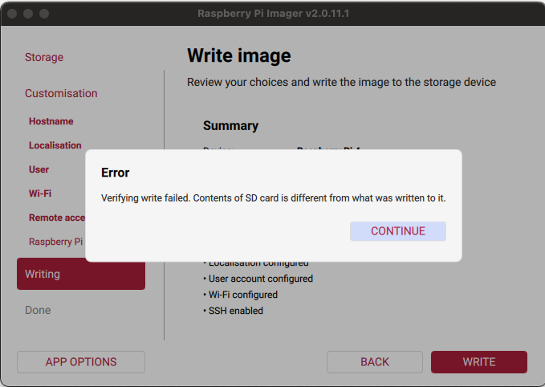
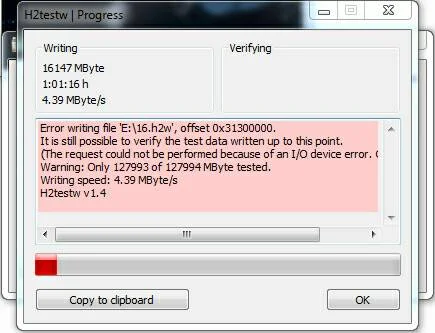
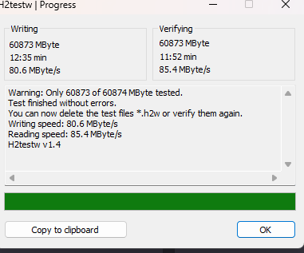
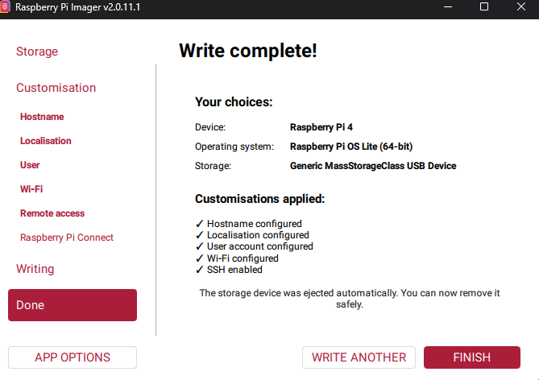
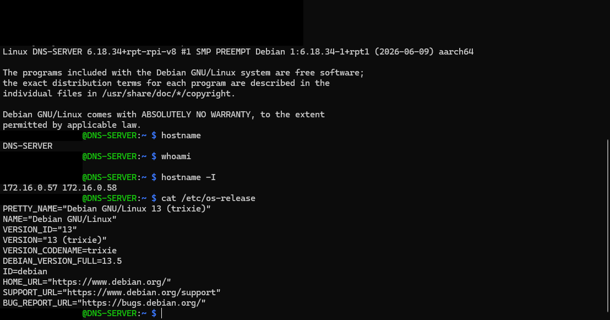
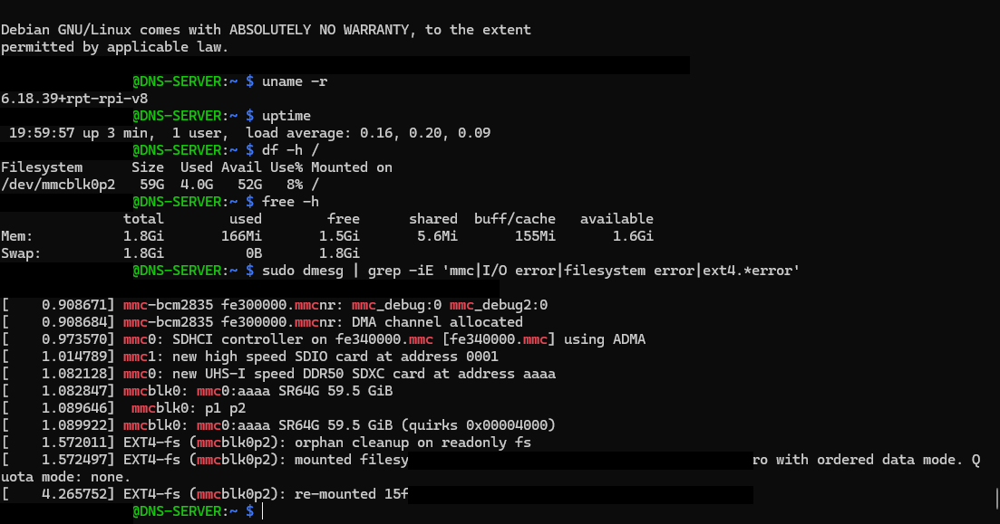

# 🛡️ Raspberry Pi DNS Security Lab

### Network-Wide DNS Filtering, Recursive Resolution & Security Hardening

A self-hosted DNS security infrastructure project built using a Raspberry Pi 4, AdGuard Home, and Unbound.

The goal of this project was to design, deploy, secure, and maintain a DNS server capable of providing network-wide ad blocking, DNS-based threat filtering, client-specific security policies, and recursive DNS resolution for devices connected to my home network.

Rather than relying entirely on external DNS providers, I configured **Unbound as a local recursive DNS resolver**, integrated it with **AdGuard Home for filtering and query monitoring**, and implemented Linux security controls to protect the server.

Throughout the project, I documented the deployment process, encountered and resolved hardware and networking issues, validated DNS functionality, and developed a Bash script to automate routine server health checks.

This project demonstrates practical experience in **Linux system administration, computer networking, DNS infrastructure, cybersecurity fundamentals, troubleshooting, and automation**.

---

## 📦 Technologies & Hardware

### Hardware

- **Raspberry Pi 4** — Dedicated DNS server
- **SanDisk ImageMate PRO 64GB microSDXC** — Operating system storage
- **Ethernet Connection** — Reliable wired network connectivity
- **NETGEAR Orbi Router** — Home network gateway, DHCP, and DNS integration
- **Windows PC** — SSH administration, DNS testing, and client policy validation

### Software & Technologies

| Technology | Purpose |
|---|---|
| Raspberry Pi OS Lite (64-bit) | Headless Linux server operating system |
| AdGuard Home | DNS filtering, query logging, and client-specific policies |
| Unbound | Recursive DNS resolution, caching, and DNSSEC validation |
| SSH / OpenSSH | Secure remote server administration |
| UFW | Host-based firewall and network access restrictions |
| NetworkManager | Network interface configuration and management |
| Bash | Automated server health checks |
| systemd / journalctl | Service management and log analysis |
| dig / nslookup | DNS resolution and troubleshooting |
| GitHub | Project documentation and version control |

---

## 🎯 Project Objectives

The primary objective was to build a secure and reliable DNS infrastructure that could operate continuously on my home network.

The project focused on the following goals:

1. **Deploy a Headless Linux Server**  
   Install Raspberry Pi OS Lite, configure SSH access, update the operating system, and validate hardware and system health.

2. **Establish Reliable Network Connectivity**  
   Configure Ethernet networking, create a DHCP reservation, and ensure the DNS server maintains a consistent local IP address.

3. **Implement Network-Wide DNS Filtering**  
   Install AdGuard Home to filter unwanted DNS requests and monitor DNS activity across the home network.

4. **Configure Client-Specific Security Policies**  
   Create persistent client profiles and apply filtering, Safe Search, browsing protection, and parental controls to selected devices.

5. **Deploy a Recursive DNS Resolver**  
   Install Unbound and configure AdGuard Home to use the local recursive resolver instead of a public upstream DNS service.

6. **Implement Security Hardening**  
   Secure SSH authentication, restrict network access with UFW, disable unnecessary services, and configure automatic security updates.

7. **Validate DNS Functionality and Security**  
   Test DNS resolution, DNSSEC validation, caching, firewall restrictions, TCP/UDP DNS connectivity, and service recovery.

8. **Develop Automated Monitoring**  
   Create a Bash script to check service availability, DNS resolution, Internet connectivity, system resources, and resolver statistics.

9. **Document Troubleshooting and Results**  
   Record configuration decisions, technical challenges, troubleshooting procedures, and final validation results.

---

## ✨ Key Features

- Network-wide DNS filtering using AdGuard Home
- Local recursive DNS resolution using Unbound
- DNSSEC validation
- DNS caching for repeated queries
- Client-specific DNS filtering policies
- Safe Search and parental controls for selected clients
- DNS query logging and statistics
- Ethernet-based server connectivity
- Router-side DHCP address reservation
- SSH key-based authentication
- Password authentication disabled for SSH
- UFW firewall restricting inbound access to the home LAN
- Unbound restricted to the local loopback interface
- Automatic security updates
- Automated Bash health-check script
- Documented troubleshooting and validation procedures

---

## 📑 Table of Contents

1. [Project Overview](#-raspberry-pi-dns-security-lab)
2. [Technologies & Hardware](#-technologies--hardware)
3. [Project Objectives](#-project-objectives)
4. [Key Features](#-key-features)
5. [Network Architecture](#-network-architecture)
6. [The Process](#-the-process)
7. [Challenges & Solutions](#-challenges--solutions)
8. [What I Learned](#-what-i-learned)
9. [Project Results](#-project-results)
10. [Future Improvements](#-future-improvements)
11. [Running & Maintaining the Project](#-running--maintaining-the-project)

---

## 🌐 Network Architecture

The DNS infrastructure uses AdGuard Home as the primary DNS filtering service and Unbound as the local recursive resolver.

Most household devices communicate through the NETGEAR Orbi router, which forwards DNS requests to AdGuard Home. Selected devices, such as the Windows PC, can be configured to communicate directly with AdGuard Home for individual client identification and filtering policies.

AdGuard Home forwards permitted DNS requests to Unbound, which performs recursive resolution and validates DNSSEC where applicable.

### DNS Request Flow

```text
              HOME NETWORK DEVICES
                       |
           +-----------+-----------+
           |                       |
           v                       v
    NETGEAR ORBI ROUTER       WINDOWS PC
       172.16.0.1            Direct DNS
           |                       |
           +-----------+-----------+
                       |
                       v
                ADGUARD HOME
               172.16.0.57:53
                       |
             DNS Filtering
             Client Policies
             Query Monitoring
                       |
                       v
                    UNBOUND
               127.0.0.1:5335
                       |
              Recursive DNS
              DNSSEC Validation
              DNS Caching
                       |
                       v
             ROOT / TLD / AUTHORITATIVE
                  DNS SERVERS
```

### Network Configuration

| Component | Configuration |
|---|---|
| Router / Default Gateway | `172.16.0.1` |
| Local Subnet | `172.16.0.0/24` |
| Raspberry Pi DNS Server | `172.16.0.57` |
| AdGuard Home DNS | `172.16.0.57:53` |
| Unbound Resolver | `127.0.0.1:5335` |
| Server Connection | Ethernet |
| IP Address Assignment | DHCP reservation |
| Remote Administration | SSH key authentication |

**Design Consideration:** The Orbi router acts as a DNS proxy for most automatically configured household devices. As a result, AdGuard Home often identifies those requests as originating from the router rather than the individual device. Direct DNS configuration was used on the Windows PC to enable client-specific filtering and more accurate query attribution.

---


## 🛠️ The Process

### Phase 2 — Raspberry Pi OS Deployment

#### Objective

The objective of this phase was to deploy a stable, headless Linux operating system on the Raspberry Pi 4 and establish secure remote administration through SSH.

I selected **Raspberry Pi OS Lite (64-bit)** because it provides a lightweight Debian-based environment without a desktop interface, allowing more system resources to be dedicated to DNS services.

This phase also involved diagnosing an unexpected storage failure, replacing defective installation media, and validating the operating system before continuing with network and DNS configuration.

---

#### Step 1 — Prepare the Raspberry Pi OS Image

I began by preparing the microSD card using Raspberry Pi Imager.

The deployment configuration included:

- **Device:** Raspberry Pi 4
- **Operating System:** Raspberry Pi OS Lite (64-bit)
- **Storage:** microSD card
- **Hostname:** `DNS-SERVER`
- **Remote Access:** SSH enabled
- **User Account:** Custom non-root user
- **Localization:** Regional and keyboard settings configured

The goal was to deploy the Raspberry Pi without requiring a dedicated monitor, keyboard, or mouse.

During the initial imaging attempts on macOS, Raspberry Pi Imager repeatedly failed during the verification stage.



*Figure 1 — Initial Raspberry Pi OS imaging attempts failed during post-write verification.*

---

#### Step 2 — Diagnose the microSD Card Failure

Rather than repeatedly attempting to reinstall the operating system, I investigated whether the storage media was responsible for the verification errors.

I used **H2testw**, a storage integrity testing utility, to perform a write-and-read verification test.

The original microSD card produced the following results:

```text
The media is likely to be defective.

4.6 GByte OK
2.4 GByte DATA LOST
646.3 MByte overwritten
1.7 GByte corrupted
646.3 MByte aliased memory
```

The results indicated that the card could not reliably retain the data written to it.

This explained why the operating system image repeatedly failed verification.



*Figure 2 — H2testw identified data loss, corruption, and overwritten data on the original microSD card.*

**Troubleshooting Outcome:** The original microSD card was identified as defective and removed from the deployment process.

---

#### Step 3 — Replace and Validate the Storage Media

I replaced the defective card with a **SanDisk ImageMate PRO 64GB microSDXC**.

Before attempting another operating system installation, I performed a full-capacity integrity test using H2testw.

The replacement card successfully completed the test:

```text
Test finished without errors.

60873 MByte written
60873 MByte verified

Write speed: 80.6 MB/s
Read speed: 85.4 MB/s
```

This confirmed that the replacement storage media could reliably write and retrieve data across its tested capacity.



*Figure 3 — Replacement SanDisk microSD card passed full-capacity write-and-read verification.*

---

#### Step 4 — Install Raspberry Pi OS Lite

With the replacement storage validated, I repeated the installation using Raspberry Pi Imager.

I selected Raspberry Pi OS Lite (64-bit), configured the hostname and user account, enabled SSH, and wrote the operating system image to the replacement microSD card.

The installation completed successfully.



*Figure 4 — Raspberry Pi Imager completed the operating system deployment successfully.*

After installation, I inserted the microSD card into the Raspberry Pi 4, connected the device to the network, and powered it on.

---

#### Step 5 — Establish Headless SSH Access

After the Raspberry Pi booted, I connected to the server remotely from my Windows PC using SSH.

```powershell
ssh <username>@dns-server.local
```

This allowed me to administer the Raspberry Pi without connecting a monitor or keyboard directly to the device.

Once connected, I verified the operating system and hardware architecture.

```bash
hostname
uname -m
cat /etc/os-release
```

The server reported:

```text
Hostname: DNS-SERVER
Architecture: aarch64
Operating System: Debian GNU/Linux 13 (trixie)
```

This confirmed that the Raspberry Pi was running a 64-bit Linux operating system.



*Figure 5 — Successful remote SSH connection and verification of the Raspberry Pi operating system.*

---

#### Step 6 — Update the Operating System

Before installing DNS applications, I updated the operating system packages.

```bash
sudo apt update
sudo apt full-upgrade -y
```

I then rebooted the server:

```bash
sudo reboot
```

After reconnecting through SSH, I checked the operating system and kernel:

```bash
uname -r
cat /etc/os-release
```

The system was running Raspberry Pi OS Lite based on Debian 13 with an updated Raspberry Pi kernel.

---

#### Step 7 — Validate System Health

I performed several checks to confirm the Raspberry Pi was stable and ready for DNS deployment.

**Check filesystem utilization:**

```bash
df -h /
```

The root filesystem reported approximately:

```text
Filesystem: /dev/mmcblk0p2
Total:      59G
Used:       ~4G
Available:  ~52G
```

**Check memory availability:**

```bash
free -h
```

The Raspberry Pi reported approximately 1.8 GiB of total RAM.

**Inspect kernel messages for storage-related errors:**

```bash
sudo dmesg | grep -iE 'mmc|error|i/o|ext4'
```

The system health review did not identify active storage I/O or filesystem errors.

**Validate network connectivity:**

```bash
ping -c 4 google.com
```

The connectivity test completed successfully.



*Figure 6 — Operating system, filesystem, and system health checks following the successful deployment.*

---

#### Challenges & Solutions

**Challenge:** Raspberry Pi Imager repeatedly failed post-write verification.

**Investigation:** Tested the original microSD card using H2testw to determine whether the problem was related to the imaging software or storage media.

**Root Cause:** The original microSD card failed integrity testing and exhibited data corruption, overwritten data, and lost data.

**Solution:** Replaced the defective storage media, verified the replacement using a full-capacity test, and successfully redeployed Raspberry Pi OS Lite.

**Lesson Learned:** When an operating system installation repeatedly fails verification, hardware integrity should be investigated before assuming the installation software or operating system image is responsible.

---

#### Phase 2 Results

By the end of this phase, I had successfully:

- Deployed Raspberry Pi OS Lite (64-bit)
- Identified and replaced defective microSD storage
- Validated replacement storage integrity
- Configured a custom hostname and non-root user
- Established headless SSH administration
- Updated operating system packages
- Verified Linux architecture and kernel information
- Confirmed filesystem and memory availability
- Validated network connectivity and system stability

**Phase 2 Status: Complete**

---
