# 🛡️ Raspberry Pi DNS Security Lab

### Network-Wide DNS Filtering, Recursive Resolution & Security Hardening

A self-hosted DNS security infrastructure project built using a Raspberry Pi 4, AdGuard Home, and Unbound.

The goal of this project was to design, deploy, secure, and maintain a DNS server capable of providing network-wide ad blocking, DNS-based threat filtering, client-specific security policies, and recursive DNS resolution for devices connected to my home network.

Rather than relying entirely on external DNS providers, I configured **Unbound as a local recursive DNS resolver**, integrated it with **AdGuard Home for filtering and query monitoring**, and implemented Linux security controls to protect the server.

Throughout the project, I documented the deployment process, encountered and resolved hardware and networking issues, validated DNS functionality, and developed a Bash script to automate routine server health checks.

This project demonstrates practical experience in **Linux system administration, computer networking, DNS infrastructure, cybersecurity fundamentals, troubleshooting, and automation**.

---

## 📦 Technologies & Hardware

### Hardware

- **Raspberry Pi 4** — Dedicated DNS server
- **SanDisk ImageMate PRO 64GB microSDXC** — Operating system storage
- **Ethernet Connection** — Reliable wired network connectivity
- **NETGEAR Orbi Router** — Home network gateway, DHCP, and DNS integration
- **Windows PC** — SSH administration, DNS testing, and client policy validation

### Software & Technologies

| Technology | Purpose |
|---|---|
| Raspberry Pi OS Lite (64-bit) | Headless Linux server operating system |
| AdGuard Home | DNS filtering, query logging, and client-specific policies |
| Unbound | Recursive DNS resolution, caching, and DNSSEC validation |
| SSH / OpenSSH | Secure remote server administration |
| UFW | Host-based firewall and network access restrictions |
| NetworkManager | Network interface configuration and management |
| Bash | Automated server health checks |
| systemd / journalctl | Service management and log analysis |
| dig / nslookup | DNS resolution and troubleshooting |
| GitHub | Project documentation and version control |

---

## 🎯 Project Objectives

The primary objective was to build a secure and reliable DNS infrastructure that could operate continuously on my home network.

The project focused on the following goals:

1. **Deploy a Headless Linux Server**  
   Install Raspberry Pi OS Lite, configure SSH access, update the operating system, and validate hardware and system health.

2. **Establish Reliable Network Connectivity**  
   Configure Ethernet networking, create a DHCP reservation, and ensure the DNS server maintains a consistent local IP address.

3. **Implement Network-Wide DNS Filtering**  
   Install AdGuard Home to filter unwanted DNS requests and monitor DNS activity across the home network.

4. **Configure Client-Specific Security Policies**  
   Create persistent client profiles and apply filtering, Safe Search, browsing protection, and parental controls to selected devices.

5. **Deploy a Recursive DNS Resolver**  
   Install Unbound and configure AdGuard Home to use the local recursive resolver instead of a public upstream DNS service.

6. **Implement Security Hardening**  
   Secure SSH authentication, restrict network access with UFW, disable unnecessary services, and configure automatic security updates.

7. **Validate DNS Functionality and Security**  
   Test DNS resolution, DNSSEC validation, caching, firewall restrictions, TCP/UDP DNS connectivity, and service recovery.

8. **Develop Automated Monitoring**  
   Create a Bash script to check service availability, DNS resolution, Internet connectivity, system resources, and resolver statistics.

9. **Document Troubleshooting and Results**  
   Record configuration decisions, technical challenges, troubleshooting procedures, and final validation results.

---

## ✨ Key Features

- Network-wide DNS filtering using AdGuard Home
- Local recursive DNS resolution using Unbound
- DNSSEC validation
- DNS caching for repeated queries
- Client-specific DNS filtering policies
- Safe Search and parental controls for selected clients
- DNS query logging and statistics
- Ethernet-based server connectivity
- Router-side DHCP address reservation
- SSH key-based authentication
- Password authentication disabled for SSH
- UFW firewall restricting inbound access to the home LAN
- Unbound restricted to the local loopback interface
- Automatic security updates
- Automated Bash health-check script
- Documented troubleshooting and validation procedures

---

## 📑 Table of Contents

1. [Project Overview](#-raspberry-pi-dns-security-lab)
2. [Technologies & Hardware](#-technologies--hardware)
3. [Project Objectives](#-project-objectives)
4. [Key Features](#-key-features)
5. [Network Architecture](#-network-architecture)
6. [The Process](#-the-process)
7. [Challenges & Solutions](#-challenges--solutions)
8. [What I Learned](#-what-i-learned)
9. [Project Results](#-project-results)
10. [Future Improvements](#-future-improvements)
11. [Running & Maintaining the Project](#-running--maintaining-the-project)

---

## 🌐 Network Architecture

The DNS infrastructure uses AdGuard Home as the primary DNS filtering service and Unbound as the local recursive resolver.

Most household devices communicate through the NETGEAR Orbi router, which forwards DNS requests to AdGuard Home. Selected devices, such as the Windows PC, can be configured to communicate directly with AdGuard Home for individual client identification and filtering policies.

AdGuard Home forwards permitted DNS requests to Unbound, which performs recursive resolution and validates DNSSEC where applicable.

### DNS Request Flow

```text
              HOME NETWORK DEVICES
                       |
           +-----------+-----------+
           |                       |
           v                       v
    NETGEAR ORBI ROUTER       WINDOWS PC
       172.16.0.1            Direct DNS
           |                       |
           +-----------+-----------+
                       |
                       v
                ADGUARD HOME
               172.16.0.57:53
                       |
             DNS Filtering
             Client Policies
             Query Monitoring
                       |
                       v
                    UNBOUND
               127.0.0.1:5335
                       |
              Recursive DNS
              DNSSEC Validation
              DNS Caching
                       |
                       v
             ROOT / TLD / AUTHORITATIVE
                  DNS SERVERS
```

### Network Configuration

| Component | Configuration |
|---|---|
| Router / Default Gateway | `172.16.0.1` |
| Local Subnet | `172.16.0.0/24` |
| Raspberry Pi DNS Server | `172.16.0.57` |
| AdGuard Home DNS | `172.16.0.57:53` |
| Unbound Resolver | `127.0.0.1:5335` |
| Server Connection | Ethernet |
| IP Address Assignment | DHCP reservation |
| Remote Administration | SSH key authentication |

**Design Consideration:** The Orbi router acts as a DNS proxy for most automatically configured household devices. As a result, AdGuard Home often identifies those requests as originating from the router rather than the individual device. Direct DNS configuration was used on the Windows PC to enable client-specific filtering and more accurate query attribution.

---


## 🛠️ The Process

### Phase 2 — Raspberry Pi OS Deployment

#### Objective

The objective of this phase was to deploy a stable, headless Linux operating system on the Raspberry Pi 4 and establish secure remote administration through SSH.

I selected **Raspberry Pi OS Lite (64-bit)** because it provides a lightweight Debian-based environment without a desktop interface, allowing more system resources to be dedicated to DNS services.

This phase also involved diagnosing an unexpected storage failure, replacing defective installation media, and validating the operating system before continuing with network and DNS configuration.

---

#### Step 1 — Prepare the Raspberry Pi OS Image

I began by preparing the microSD card using Raspberry Pi Imager.

The deployment configuration included:

- **Device:** Raspberry Pi 4
- **Operating System:** Raspberry Pi OS Lite (64-bit)
- **Storage:** microSD card
- **Hostname:** `DNS-SERVER`
- **Remote Access:** SSH enabled
- **User Account:** Custom non-root user
- **Localization:** Regional and keyboard settings configured

The goal was to deploy the Raspberry Pi without requiring a dedicated monitor, keyboard, or mouse.

During the initial imaging attempts on macOS, Raspberry Pi Imager repeatedly failed during the verification stage.


*Figure 1 — Initial Raspberry Pi OS imaging attempts failed during post-write verification.*

---

#### Step 2 — Diagnose the microSD Card Failure

Rather than repeatedly attempting to reinstall the operating system, I investigated whether the storage media was responsible for the verification errors.

I used **H2testw**, a storage integrity testing utility, to perform a write-and-read verification test.

The original microSD card produced the following results:

```text
The media is likely to be defective.

4.6 GByte OK
2.4 GByte DATA LOST
646.3 MByte overwritten
1.7 GByte corrupted
646.3 MByte aliased memory
```

The results indicated that the card could not reliably retain the data written to it.

This explained why the operating system image repeatedly failed verification.


*Figure 2 — H2testw identified data loss, corruption, and overwritten data on the original microSD card.*

**Troubleshooting Outcome:** The original microSD card was identified as defective and removed from the deployment process.(Original screenshot unavailable. During testing, H2testw reported approximately 2.4 GB of data loss on the original microSD card. I replaced the card and confirmed the replacement passed testing.)

---

#### Step 3 — Replace and Validate the Storage Media

I replaced the defective card with a **SanDisk ImageMate PRO 64GB microSDXC**.

Before attempting another operating system installation, I performed a full-capacity integrity test using H2testw.

The replacement card successfully completed the test:

```text
Test finished without errors.

60873 MByte written
60873 MByte verified

Write speed: 80.6 MB/s
Read speed: 85.4 MB/s
```

This confirmed that the replacement storage media could reliably write and retrieve data across its tested capacity.


*Figure 3 — Replacement SanDisk microSD card passed full-capacity write-and-read verification.*

---

#### Step 4 — Install Raspberry Pi OS Lite

With the replacement storage validated, I repeated the installation using Raspberry Pi Imager.

I selected Raspberry Pi OS Lite (64-bit), configured the hostname and user account, enabled SSH, and wrote the operating system image to the replacement microSD card.

The installation completed successfully.


*Figure 4 — Raspberry Pi Imager completed the operating system deployment successfully.*

After installation, I inserted the microSD card into the Raspberry Pi 4, connected the device to the network, and powered it on.

---

#### Step 5 — Establish Headless SSH Access

After the Raspberry Pi booted, I connected to the server remotely from my Windows PC using SSH.

```powershell
ssh <username>@dns-server.local
```

This allowed me to administer the Raspberry Pi without connecting a monitor or keyboard directly to the device.

Once connected, I verified the operating system and hardware architecture.

```bash
hostname
uname -m
cat /etc/os-release
```

The server reported:

```text
Hostname: DNS-SERVER
Architecture: aarch64
Operating System: Debian GNU/Linux 13 (trixie)
```

This confirmed that the Raspberry Pi was running a 64-bit Linux operating system.


*Figure 5 — Successful remote SSH connection and verification of the Raspberry Pi operating system.*

---

#### Step 6 — Update the Operating System

Before installing DNS applications, I updated the operating system packages.

```bash
sudo apt update
sudo apt full-upgrade -y
```

I then rebooted the server:

```bash
sudo reboot
```

After reconnecting through SSH, I checked the operating system and kernel:

```bash
uname -r
cat /etc/os-release
```

The system was running Raspberry Pi OS Lite based on Debian 13 with an updated Raspberry Pi kernel.

---

#### Step 7 — Validate System Health

I performed several checks to confirm the Raspberry Pi was stable and ready for DNS deployment.

**Check filesystem utilization:**

```bash
df -h /
```

The root filesystem reported approximately:

```text
Filesystem: /dev/mmcblk0p2
Total:      59G
Used:       ~4G
Available:  ~52G
```

**Check memory availability:**

```bash
free -h
```

The Raspberry Pi reported approximately 1.8 GiB of total RAM.

**Inspect kernel messages for storage-related errors:**

```bash
sudo dmesg | grep -iE 'mmc|error|i/o|ext4'
```

The system health review did not identify active storage I/O or filesystem errors.

**Validate network connectivity:**

```bash
ping -c 4 google.com
```

The connectivity test completed successfully.


*Figure 6 — Operating system, filesystem, and system health checks following the successful deployment.*

---

#### Challenges & Solutions

**Challenge:** Raspberry Pi Imager repeatedly failed post-write verification.

**Investigation:** Tested the original microSD card using H2testw to determine whether the problem was related to the imaging software or storage media.

**Root Cause:** The original microSD card failed integrity testing and exhibited data corruption, overwritten data, and lost data.

**Solution:** Replaced the defective storage media, verified the replacement using a full-capacity test, and successfully redeployed Raspberry Pi OS Lite.

**Lesson Learned:** When an operating system installation repeatedly fails verification, hardware integrity should be investigated before assuming the installation software or operating system image is responsible.

---

#### Phase 2 Results

By the end of this phase, I had successfully:

- Deployed Raspberry Pi OS Lite (64-bit)
- Identified and replaced defective microSD storage
- Validated replacement storage integrity
- Configured a custom hostname and non-root user
- Established headless SSH administration
- Updated operating system packages
- Verified Linux architecture and kernel information
- Confirmed filesystem and memory availability
- Validated network connectivity and system stability

**Phase 2 Status: Complete**

---

# Phase 3 — Network Configuration and DHCP Reservation

## Objective

Give the Raspberry Pi DNS server a consistent address and confirm reliable wired connectivity before deploying AdGuard Home.

## Network configuration

| Setting | Value |
| --- | --- |
| Hostname | DNS-SERVER |
| Wired interface | eth0 |
| Reserved IPv4 address | 172.16.0.57 |
| Subnet | 172.16.0.0/24 |
| Default gateway | 172.16.0.1 |
| Router | Netgear Orbi |

These are private LAN addresses. They describe this lab and should not be copied into a different network without checking its configuration.

## 1. Identify the Ethernet interface

I checked the wired interface and its assigned IPv4 address:

```bash
ip link show eth0
ip -4 addr show eth0
```

The recovered output shows eth0 in the UP state with address 172.16.0.57/24. The Ethernet hardware address was used to identify the correct adapter for the router reservation; it has been hidden in the published screenshot.

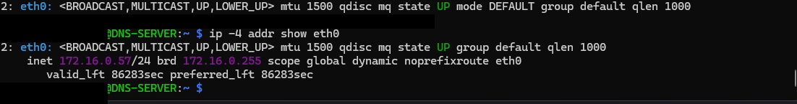

## 2. Reserve the address in Orbi

I created a DHCP address reservation in the Orbi router for the Pi's Ethernet adapter, assigning 172.16.0.57.

A DHCP reservation tells the router to keep assigning the same address to that adapter. The Pi still obtains its network settings through DHCP; this is different from configuring a static address directly on the Pi. A consistent address allows clients to keep using the Pi as their DNS server.

The recovered Orbi Address Reservation table shows DNS-SERVER reserved at 172.16.0.57. The published image is cropped to this table, with the MAC address masked.

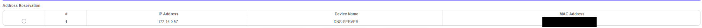

## 3. Reboot and verify SSH access

After saving the reservation, I rebooted the Pi and reconnected using its reserved address:

```bash
sudo reboot
```

From the client computer:

```text
ssh <your-pi-username>@172.16.0.57
```

The original screenshot shows the reboot disconnect followed by a successful SSH login to 172.16.0.57. The username, local client path and SSH host fingerprint are redacted. The placeholder above is documentation, not a replacement for original command output.

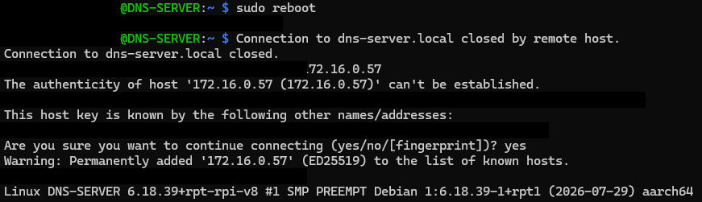

## 4. Verify the assigned address, route and internet access

```bash
ip -4 addr show eth0
ip route
ping -c 4 8.8.8.8
```

The recovered output shows:

- Ethernet address: 172.16.0.57/24.
- Ethernet default gateway: 172.16.0.1, with route metric 100.
- Wi-Fi was still active at capture time, using 172.16.0.58 and default-route metric 600.
- The Ethernet route had the lower metric and was preferred.
- All four internet ping requests received replies, with 0% packet loss.

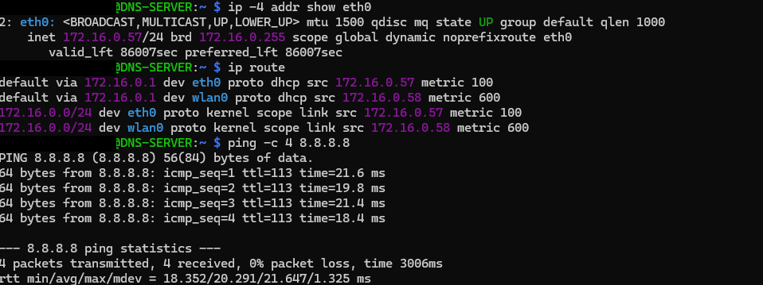

The established filename is retained. This screenshot supports address, routing and connectivity validation; it does not display the router reservation itself.

## 5. Use Ethernet for the DNS server

Later in the project, I disabled Wi-Fi so the server used its wired connection:

```bash
sudo nmcli radio wifi off
```

The recovered Ethernet-only screenshot confirms `nmcli radio wifi` returned `disabled`, `eth0` was connected, and `wlan0` was unavailable.

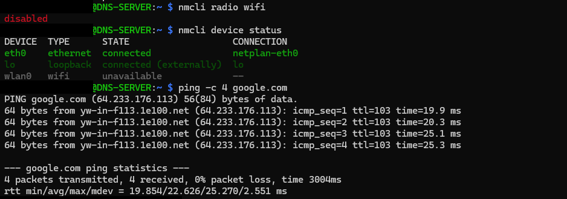

The same screenshot records the domain-name connectivity check:

```bash
ping -c 4 google.com
```

The domain resolved to an IPv4 address and all four ping requests received replies, with 0% packet loss.

## Outcome

The recovered evidence shows the Orbi reservation for 172.16.0.57, successful SSH access at that address after reboot, Ethernet interface and routing validation, and later Ethernet-only operation with successful domain-name connectivity. The earlier routing screenshot still shows Wi-Fi active; the later validation confirms it was disabled.

## Screenshot inventory and evidence status

| Filename | Evidence |
| --- | --- |
| phase-3-01-dhcp-reservation-validation.png | Assigned Ethernet address, preferred route, internet ping |
| phase-3-02-reboot-ssh-validation.png | Reboot and subsequent successful SSH login |
| phase-3-03-ethernet-interface-validation.png | Ethernet link UP and assigned IPv4 address; retained from the original ZIP |
| phase-3-04-router-dhcp-reservation.png | Orbi Address Reservation table |
| phase-3-05-ethernet-only-network-validation.png | Wi-Fi disabled, Ethernet connected, successful domain ping |

Both previously listed Phase 3 screenshot gaps have been filled by recovered uploads. No screenshots were fabricated. The uploaded Ethernet-only image originally used number 02; its published filename is number 05 to preserve the original ZIP's existing 02 reboot image and prevent collisions. Unredacted originals and the redundant connected-device list are not included.


# Phase 4 — AdGuard Home Installation and Configuration

## Objective

Deploy AdGuard Home on the Raspberry Pi, bind its services to Ethernet, and verify DNS resolution and controlled filtering.

## Lab settings

| Setting | Value |
| --- | --- |
| Host | DNS-SERVER, Raspberry Pi 4 |
| Ethernet interface | eth0 |
| Reserved address | 172.16.0.57 |
| Installation directory | /opt/AdGuardHome |
| Version recorded during setup | v0.107.79 |
| Initial setup URL | http://172.16.0.57:3000 |
| Configured admin URL | http://172.16.0.57/ |
| DNS service | UDP and TCP port 53 |

This document records the existing lab. Commands below describe validation steps; they are not newly executed test results.

## 1. Install AdGuard Home

I used the AdGuard Home installation script for the Raspberry Pi's ARM64 environment. The project conversation records installation in /opt/AdGuardHome, automatic service startup and the initial setup address http://172.16.0.57:3000.

The recovered installer output confirms successful installation, that the service was running, and that it was configured to start automatically on boot. It also displays the initial setup URL. The exact installation command is not visible in this screenshot and is not reconstructed here.

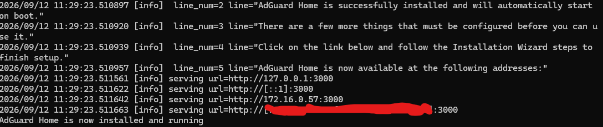

## 2. Configure web and DNS interfaces

In the setup wizard, I selected the Ethernet interface for both services:

- Admin Web Interface: eth0 / 172.16.0.57, port 80.
- DNS server: eth0 / 172.16.0.57, port 53.

The web interface moved from the initial setup port 3000 to the configured HTTP port 80. The DHCP reservation documented in Phase 3 provides the consistent address needed by clients.

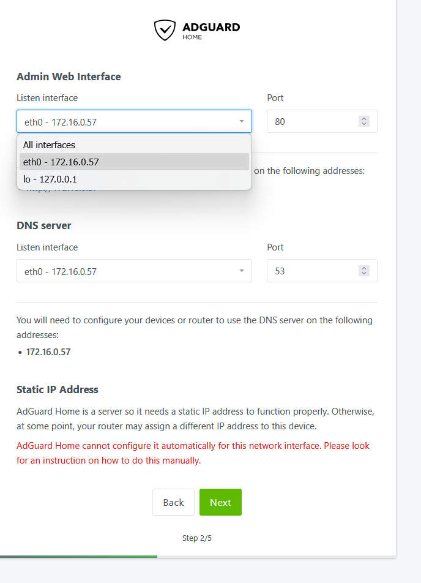

This screenshot shows the wizard settings before completion. The later socket output confirms the running services were bound to 172.16.0.57.

An administrator account was configured during setup. Credentials are intentionally excluded; the account-creation screen was not recovered.

## 3. Validate the running service and listening ports

From the installation directory, the service status can be checked with:

```bash
cd /opt/AdGuardHome
sudo ./AdGuardHome -s status
```

I checked listening sockets and queried the DNS server directly:

```bash
sudo ss -tulpn | grep -E ':53 |:80 '
nslookup example.com 172.16.0.57
```

The recovered terminal screenshot shows:

- AdGuard Home service status: running.
- UDP 172.16.0.57:53 and TCP 172.16.0.57:53 owned by AdGuardHome.
- An example.com response containing IPv4 and IPv6 answers from DNS server 172.16.0.57.

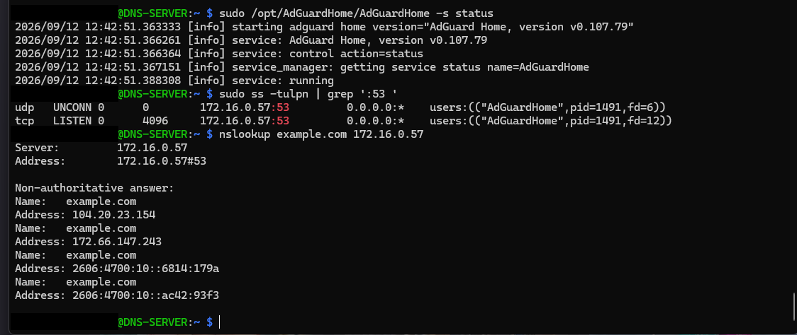

During the original work, nslookup was initially unavailable; dnsutils was installed before the lookup tests. The screenshot above shows the later successful lookup, not the package-install step. Resolved website addresses are historical and can change.

## 4. Confirm requests in the Query Log

I opened the AdGuard Home Query Log to verify that the server recorded the test requests. The recovered image shows example.com A and AAAA requests marked Processed, with the client identified as DNS-SERVER at 172.16.0.57.

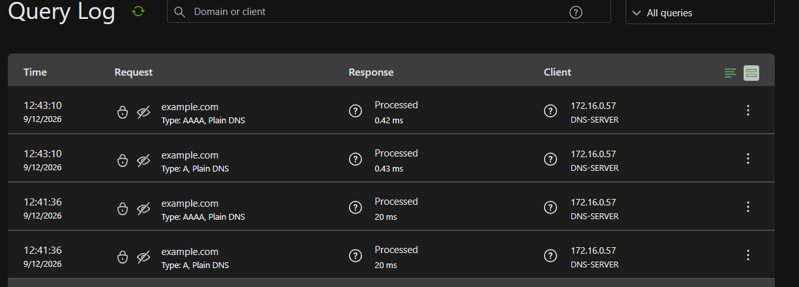

These requests came from the Pi itself. This proves local direct-query processing; it does not establish that every household device was using AdGuard Home.

## 5. Validate filtering with a controlled test

I used example.org for a controlled blocking test. The recovered Query Log shows its A and AAAA requests marked Blocked by Custom filtering rules, alongside processed example.com requests.

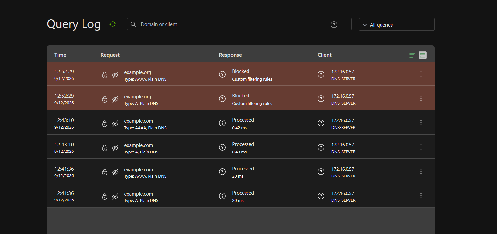

This demonstrates the custom rule was applied to the test domain. It is not evidence that example.org is malicious, or a benchmark of general ad blocking. The exact custom-rule text and the corresponding terminal blocked response were not recovered in this image set.

## 6. Additional service-health validation

A later validation screenshot shows AdGuard Home running, DNS listening on UDP/TCP 172.16.0.57:53, and the web interface listening on TCP 172.16.0.57:80. A direct example.com lookup succeeds, eth0 is connected, and wlan0 is unavailable.

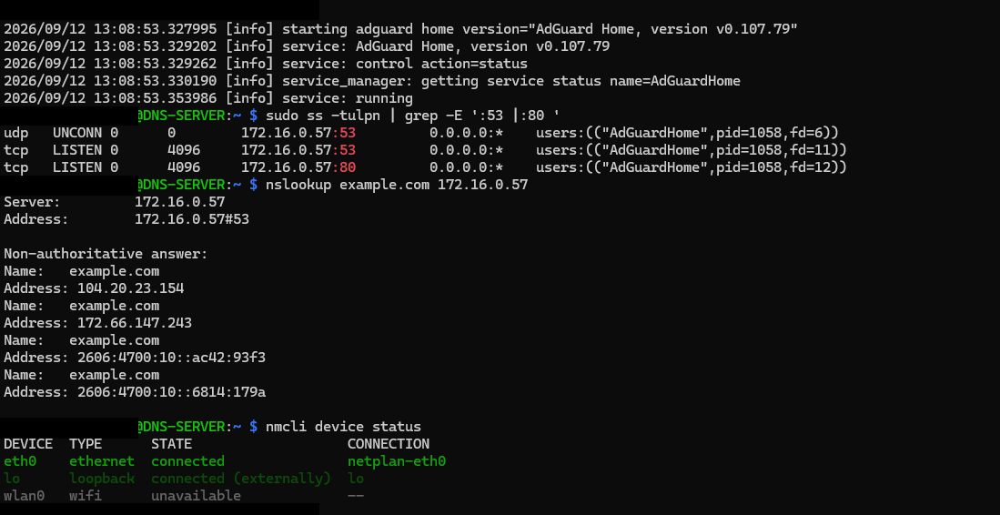

The original filename is retained for consistency. This image does not show a reboot sequence or uptime, so it confirms service health but does not independently prove persistence across reboot. The installer message confirms automatic startup was configured; it does not by itself verify a successful restart after reboot.

## Outcome

The six recovered screenshots document successful installation, Ethernet-bound web and DNS settings, a running AdGuard Home service, UDP/TCP DNS listeners, successful direct DNS resolution, query logging, controlled filtering and a later service-health check.

The test queries shown came from the Pi itself. They do not establish that every household device was using AdGuard Home; client configuration and testing are documented separately.

## Evidence limitations

All six screenshot files are available. The reboot and reconnect sequence itself is not shown, so reboot persistence remains unverified by these images alone. Administrator-account creation, the dnsutils package installation and the exact custom-filter rule text are not pictured. No images or command output were fabricated to fill these gaps.

Usernames are redacted in the published terminal images. The installer image retains its existing redaction. Private LAN addresses, generic hostnames and public test domains remain visible to explain the lab.
---

# Phase 5 — Network-Wide DNS Integration

## Objective

Extend AdGuard Home beyond DNS requests made on the Raspberry Pi itself. In this phase, I configured a Windows PC to use the Raspberry Pi directly and configured the NETGEAR Orbi router to forward DNS requests to AdGuard Home. I then used the AdGuard Home Query Log to examine which clients reached the server and which requests were filtered.

The DNS server was `172.16.0.57` (TCP/UDP port 53), the Orbi gateway was `172.16.0.1`, and the Windows PC was `172.16.0.74` on the `172.16.0.0/24` private LAN.

## 1. Verify DNS connectivity from Windows

Before changing the client DNS settings, I checked whether Windows could reach the DNS server over TCP port 53:

```powershell
Test-NetConnection 172.16.0.57 -Port 53
```

The original lab recorded `TcpTestSucceeded : True`. This verifies a TCP connection to port 53, not DNS resolution over UDP. **The four recovered Phase 5 screenshots do not show this PowerShell output**, so I have not assigned a Query Log image to this step.

## 2. Configure Windows to use AdGuard Home

On the Windows PC, I opened **Settings → Network & Internet → Ethernet → DNS Server Assignment → Edit**, selected manual IPv4 configuration, set the preferred DNS server to `172.16.0.57`, left the alternate DNS server blank, and disabled DNS over HTTPS for this connection.

I checked the assigned DNS server and performed a default-server lookup:

```powershell
Get-DnsClientServerAddress
nslookup github.com
```

The original lab recorded that the Windows client used `172.16.0.57` for the lookup. The recovered Query Log independently shows queries originating from the Windows client at `172.16.0.74`.

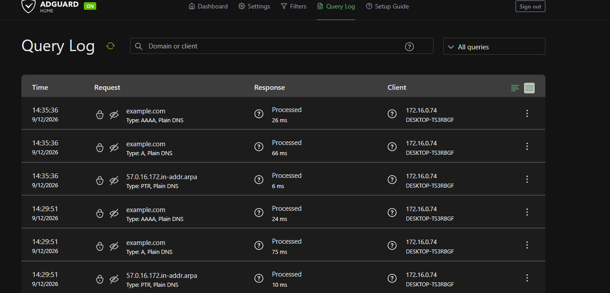

*Figure 1 — AdGuard Home processed `example.com` A/AAAA requests attributed to Windows client `172.16.0.74`. This demonstrates client DNS activity, not the PowerShell connectivity test.*

## 3. Confirm DNS filtering on the Windows client

I inspected the AdGuard Home Query Log after the Windows DNS change. It recorded both permitted requests and requests blocked by AdGuard's DNS filter for `172.16.0.74`.

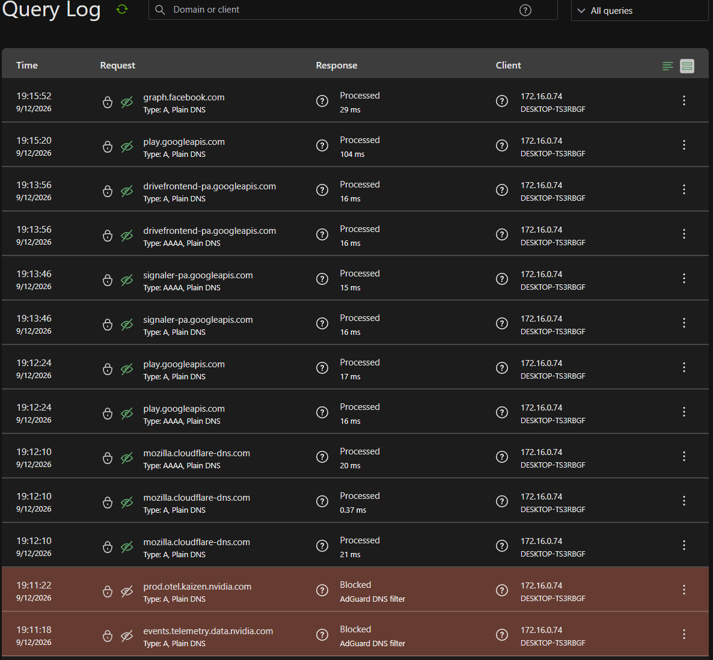

*Figure 2 — Windows client `172.16.0.74` has processed requests and blocked NVIDIA telemetry requests. This demonstrates that filtering was active for this client.*

These log entries demonstrate filtering decisions for the recorded requests. They do not prove that every application on Windows always uses the system DNS settings.

## 4. Configure NETGEAR Orbi DNS forwarding

The router's LAN DHCP settings did not expose the custom DNS distribution option needed for this setup. I instead configured the router's **Internet Setup** DNS setting to use `172.16.0.57`.

At this stage, AdGuard Home forwarded permitted requests to the configured Quad9 DNS-over-HTTPS upstream. Unbound was added later in Phase 7.

```text
Household devices
       |
       v
NETGEAR Orbi DNS proxy (172.16.0.1)
       |
       v
AdGuard Home (172.16.0.57:53)
       |
       v
Quad9 upstream resolver (at this stage)
```

## 5. Verify router-forwarded household DNS traffic

The AdGuard Home Query Log recorded processed and blocked requests attributed to `172.16.0.1`, the Orbi router. The domains included requests associated with multiple services, such as Apple and TikTok.

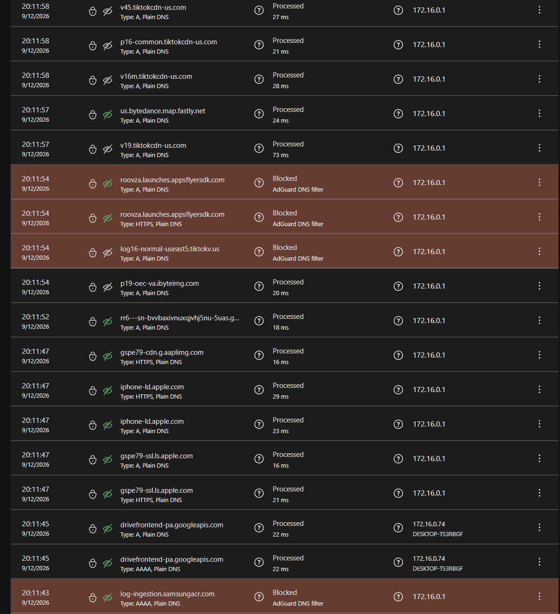

*Figure 3 — The Query Log shows permitted and blocked requests attributed to router address `172.16.0.1`, consistent with Orbi DNS forwarding.*

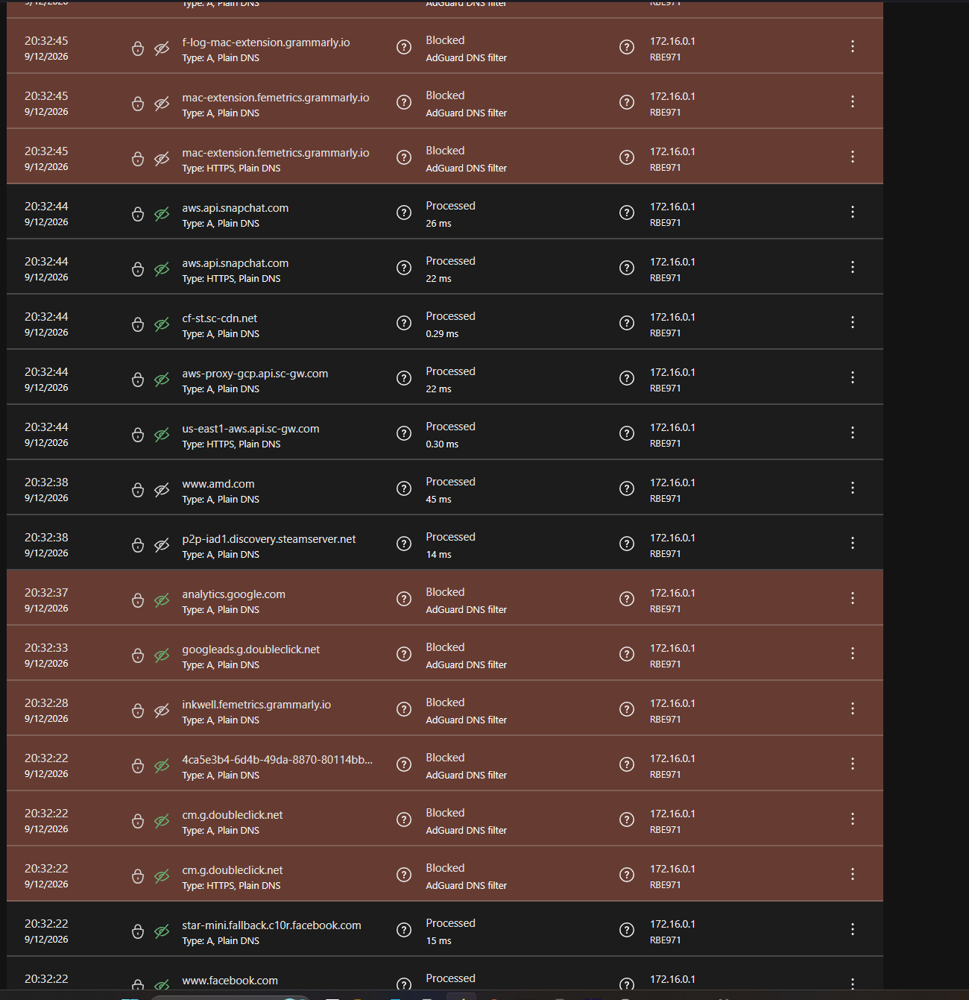

*Figure 4 — Additional queries attributed to `172.16.0.1` include blocked advertising and analytics domains and permitted application requests. This is supplementary filtering evidence, **not a reboot-persistence test**.*

**Client attribution limitation:** When the Orbi forwards DNS on behalf of household devices, AdGuard Home often records the router IP rather than the original device IP. The Windows PC, which was configured directly, appeared as `172.16.0.74`. Therefore, the router-proxied logs demonstrate DNS activity through the router, but they do not reliably identify each individual household device.

## Challenges and solutions

- **Client adoption:** A working DNS server does not mean clients use it automatically. I set the Windows preferred DNS address to the Raspberry Pi and verified client activity in the Query Log.
- **Router configuration:** Because the desired custom DNS setting was unavailable in Orbi's LAN DHCP options, I used the router's Internet Setup DNS configuration.
- **Client identification:** Orbi DNS proxying grouped many requests under `172.16.0.1`. Directly configuring a client, as with Windows, allowed AdGuard Home to identify that client separately.

## Outcome

The recorded lab tests and recovered Query Logs support these Phase 5 results:

- Windows client `172.16.0.74` sent DNS requests to AdGuard Home.
- AdGuard Home processed and blocked selected Windows client requests.
- The Orbi router `172.16.0.1` forwarded DNS requests to AdGuard Home.
- AdGuard Home processed and blocked selected router-forwarded requests.
- Router DNS proxying limited per-device attribution, which informed the client-specific filtering work in Phase 6.

## Evidence limitations

The four recovered images are all AdGuard Home Query Logs. They do **not** display `Test-NetConnection`, `Get-DnsClientServerAddress`, `nslookup`, router DNS settings, or a reboot/reconnect sequence. The commands and configuration steps above are retained from the original project record, but the screenshots must not be captioned as proof of those separate actions. Reboot persistence is not established by this Phase 5 image set.

The images contain private LAN IP addresses, a Windows hostname, router-associated hostname labels, and requested domain names. They do not visibly expose administrator passwords, private SSH keys, or public WAN addresses. Review the domain history and device names before publishing if you want to keep household activity private.

**Phase 5 Status: Complete — with screenshot evidence limited as described above.**

---

---

# Phase 6 — Client-Specific DNS Filtering & Family Protection

## Objective

The objective of this phase was to configure client-specific DNS security policies using AdGuard Home and validate that different devices could receive different filtering behavior.

During Phase 5, I successfully integrated my Raspberry Pi DNS server with a Windows client and the NETGEAR Orbi router.

However, the Orbi router acted as a DNS proxy, forwarding DNS requests under its own IP address (`172.16.0.1`). This limited AdGuard Home's ability to identify individual household devices.

To address this limitation, I configured my Windows PC as a persistent client in AdGuard Home and enabled custom security policies, including DNS filtering, browsing security, parental controls, and Safe Search.

I then validated the policies using controlled DNS queries and AdGuard Home's Query Log.

---

## Step 1 — Configure a Persistent Windows Client

I opened the AdGuard Home administration interface and navigated to:

**Settings → Client settings**

Under **Persistent clients**, I configured the following client:

| Setting | Value |
|---|---|
| Client name | `Windows-PC` |
| Client identifier | `172.16.0.74` |
| Client settings | Custom |
| Blocked services | Global |
| Upstream DNS servers | Global |

This configuration allowed AdGuard Home to associate DNS requests from `172.16.0.74` with the Windows PC and apply custom client-specific protection settings.

The client overview also displayed its accumulated DNS request count, confirming that AdGuard Home was tracking activity associated with the persistent client.

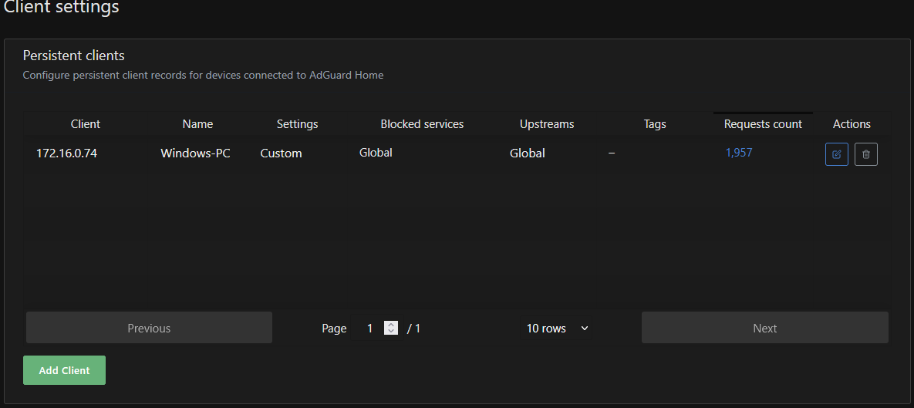

*Figure 1 — AdGuard Home Persistent Clients page showing Windows-PC configured with a custom client policy.*

---

## Step 2 — Configure Client-Specific Security Settings

I opened the Windows-PC client configuration and reviewed the available protection settings.

I disabled **Use global settings**, allowing the Windows PC to use its own protection configuration rather than inheriting all global settings.

The following security features were enabled:

- Block domains using filters and hosts files
- Use AdGuard browsing security web service
- Use AdGuard parental control web service
- Use Safe Search

Safe Search was enabled for the following supported services:

- Bing
- DuckDuckGo
- Ecosia
- Google
- Pixabay
- Yandex
- YouTube

The options to ignore the client in the Query Log and statistics were disabled, allowing DNS requests from Windows-PC to remain visible for monitoring and troubleshooting.

The client continued using the global blocked-service configuration and global upstream DNS settings, as indicated in the persistent-client overview.

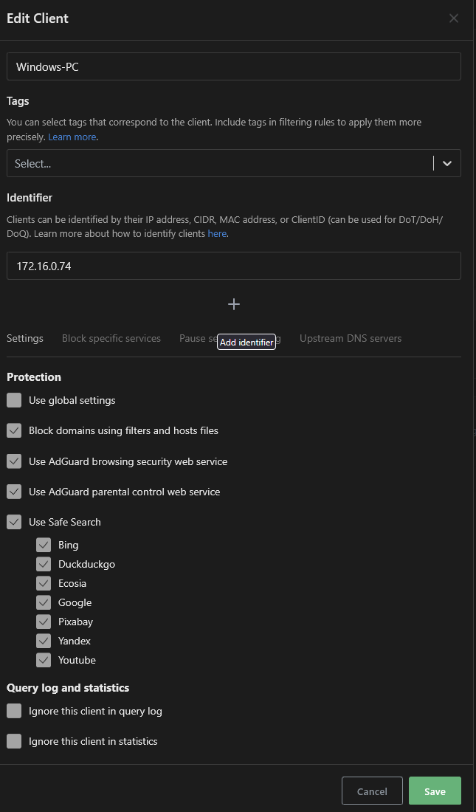

*Figure 2 — Custom DNS filtering, browsing security, parental controls, and Safe Search settings configured for Windows-PC.*

---

## Step 3 — Validate Client-Specific DNS Filtering

To verify that custom filtering policies could affect the Windows PC independently, I tested DNS queries for:

`example.org`

I reviewed the resulting requests in AdGuard Home's Query Log.

The log showed the following behavior:

| Client | IP Address | DNS Response |
|---|---|---|
| Windows-PC | `172.16.0.74` | Blocked — Custom filtering rules |
| Orbi router | `172.16.0.1` | Processed |

For the Windows PC, both A and AAAA requests were blocked by custom filtering rules.

Meanwhile, requests associated with the Orbi router were processed.

The log also retained earlier requests from Windows-PC that had been processed before the blocked results.

This demonstrated that AdGuard Home could apply different DNS filtering outcomes based on the identified client.

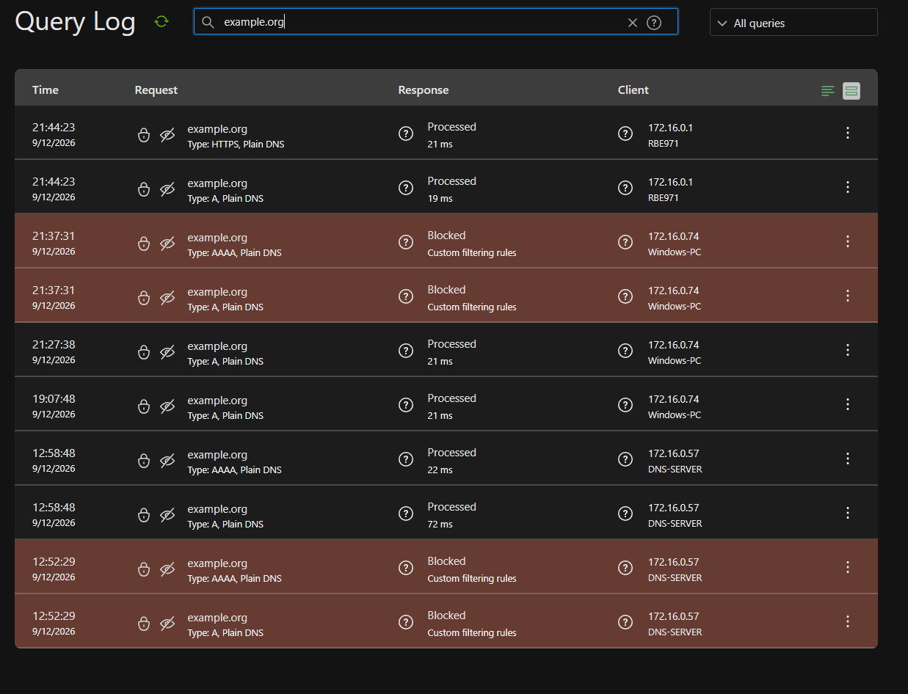

*Figure 3 — Query Log showing example.org blocked for Windows-PC while requests from the Orbi router were processed.*

**Result:** The observed DNS responses demonstrated successful client-specific filtering behavior.

---

## Step 4 — Validate Safe Search Enforcement

Next, I tested AdGuard Home's Safe Search handling using Google DNS requests.

I filtered the Query Log for:

`www.google.com`

The results showed:

| Client | IP Address | Response |
|---|---|---|
| Windows-PC | `172.16.0.74` | Safe Search |
| Orbi router | `172.16.0.1` | Processed |

The Windows PC's Google A and AAAA DNS requests were labeled **Safe Search**.

Requests associated with the Orbi router were processed normally.

This provided evidence that AdGuard Home was applying Safe Search DNS handling to the Windows client while treating router-forwarded requests differently.

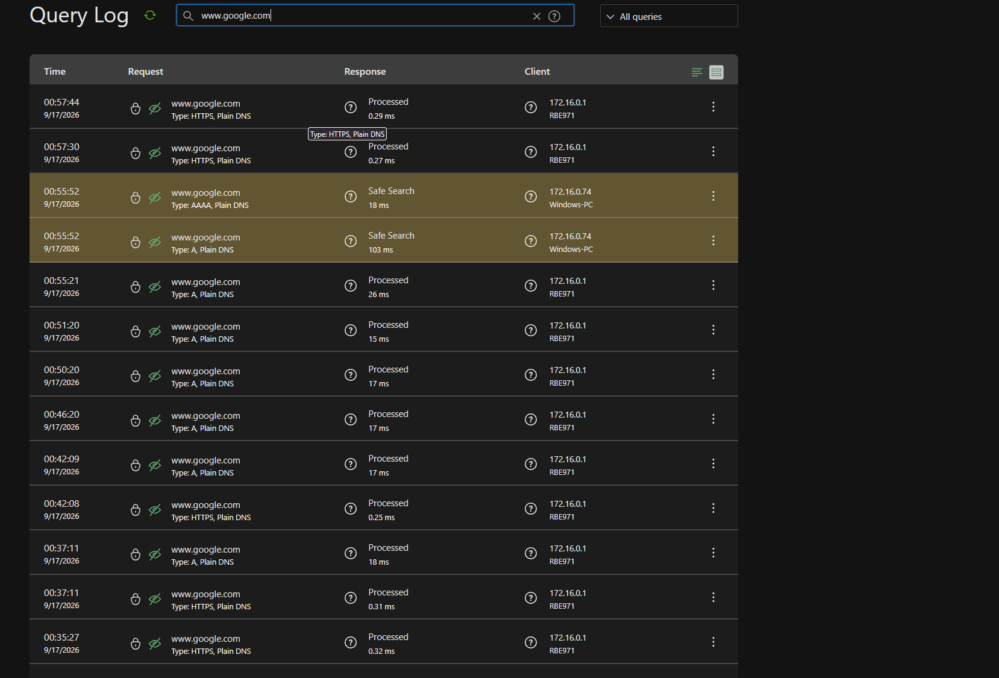

*Figure 4 — Query Log showing Safe Search responses for Windows-PC and normal processed responses for the Orbi router.*

**Evidence limitation:** The Query Log confirms AdGuard Home's Safe Search DNS handling. It does not independently demonstrate the resulting search engine settings or browser-level content filtering.

---

## Step 5 — Validate Client-Specific Service Blocking

To test application and service blocking, I reviewed DNS requests associated with Amazon.

The Query Log showed requests for:

`www.amazon.com`

For the Windows PC, AdGuard Home returned:

**Blocked service — Amazon**

The log recorded blocked A and HTTPS DNS queries for the Windows client.

An Amazon-related hostname requested through the Orbi router was processed.

| Client | Requested Domain | Result |
|---|---|---|
| Windows-PC (`172.16.0.74`) | `www.amazon.com` | Blocked service — Amazon |
| Orbi router (`172.16.0.1`) | `unagi-na.amazon.com` | Processed |

This demonstrated that AdGuard Home's service-blocking feature was active for the Windows PC.

However, because the two clients requested different Amazon-related domains, the screenshot does not independently prove how both clients would have handled the exact same domain.

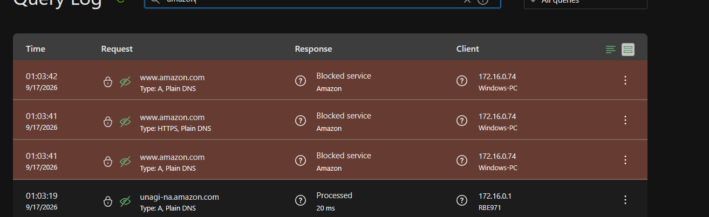

*Figure 5 — AdGuard Home Query Log showing Amazon service blocking for Windows-PC and a processed Amazon-related request from the Orbi router.*

**Result:** The Windows client received the expected blocked-service DNS responses.

---

## Challenges & Solutions

### Challenge 1 — Router DNS Proxy Limited Individual Client Identification

**Problem:**

The NETGEAR Orbi router forwarded household DNS queries using its own address, `172.16.0.1`.

As a result, AdGuard Home could not reliably distinguish every individual device behind the router.

**Solution:**

I configured the Windows PC to communicate directly with AdGuard Home and registered it as a persistent client using `172.16.0.74`.

This allowed custom policies to be associated with that client.

### Challenge 2 — Applying Different DNS Policies to Different Clients

**Problem:**

Global filtering policies are not sufficient when individual devices require different security restrictions.

**Solution:**

I disabled global protection settings for the Windows persistent client and enabled custom security controls.

I then compared Query Log responses from Windows-PC and the Orbi router.

The results showed different filtering outcomes for `example.org` and Google Safe Search requests.

### Challenge 3 — Verifying Filtering Without Relying Only on Configuration Screenshots

**Problem:**

An enabled checkbox does not independently prove that DNS filtering is working.

**Solution:**

I used AdGuard Home's Query Log to validate actual DNS responses.

The screenshots demonstrated:

- Custom filtering rules blocking `example.org`
- Safe Search handling for `www.google.com`
- Amazon service blocking for the Windows PC
- Processed requests associated with the Orbi router

This provided evidence of both configured security policies and observed DNS behavior.

---

## Phase 6 Results

By the end of Phase 6, I had successfully:

- Configured a persistent Windows client in AdGuard Home.
- Assigned a recognizable client name and LAN IP identifier.
- Enabled custom DNS protection settings.
- Enabled browsing security and parental control services.
- Enabled Safe Search for seven supported services.
- Verified custom filtering rules using `example.org`.
- Verified Safe Search DNS handling using Google requests.
- Verified Amazon service blocking for Windows-PC.
- Compared direct-client and router-forwarded DNS behavior.
- Documented the limitations introduced by the Orbi DNS proxy.

### Evidence Summary

| Screenshot | Verified Evidence |
|---|---|
| 01 | Persistent Windows client registration |
| 02 | Custom security and Safe Search configuration |
| 03 | Client-specific DNS filtering |
| 04 | Safe Search DNS handling |
| 05 | Amazon service blocking |

### Evidence Limitations

The screenshots demonstrate AdGuard Home configuration and recorded DNS filtering behavior.

They do not independently verify that every household device received an individually assigned policy, that Safe Search restricted browser-visible results, or that every Amazon-related domain was blocked.

The Orbi DNS proxy continued to limit individual identification of devices whose requests were forwarded through the router.

**Phase 6 Status: Complete**

---

---

# Phase 7 — Unbound Recursive DNS & DNSSEC

## Objective

In this phase, I verified a local Unbound DNS resolver on my Raspberry Pi, checked its integration with AdGuard Home, and tested DNSSEC validation.

The intended DNS path is:

```text
Windows PC / Household Devices
            |
            v
AdGuard Home — 172.16.0.57:53
            |
            v
Unbound — 127.0.0.1:5335
            |
            v
DNS infrastructure
```

The screenshots establish that Unbound was running and accepting local queries, AdGuard Home was configured to use it as an upstream, and DNSSEC tests produced the expected results.

They do not independently establish whether Unbound uses full recursion rather than forwarding, or prove the exact upstream path taken by every query.

---

## Step 1 — Verify Unbound Service Health

I connected to the Raspberry Pi using SSH key authentication and checked the service:

```bash
sudo systemctl status unbound --no-pager
```

The service was **loaded**, **enabled**, and **active (running)**.

The log identified Unbound **1.26.2**, with the `validator` and `iterator` modules initialized.

The observed service start was October 24, 2026, at 06:43 EDT.

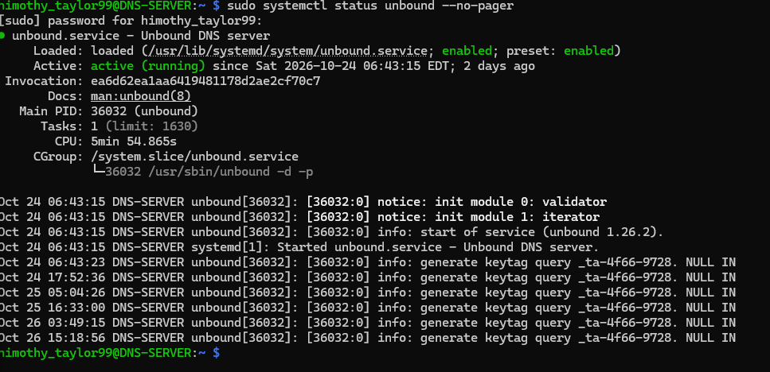

*Figure 1 — Unbound service running, enabled, and reporting validator/iterator initialization.*

An enabled service is configured to start at boot, but this screenshot alone does not demonstrate a successful restart following a reboot.

---

## Step 2 — Verify the Local DNS Listener

I checked which interfaces and ports Unbound was listening on:

```bash
sudo ss -tulnp | grep 5335
```

The output showed the `unbound` process listening on **127.0.0.1:5335** over both UDP and TCP.

The observed process ID was `36032`.

This local-only listener separates Unbound from AdGuard Home's client-facing port 53 and avoids exposing Unbound directly on the LAN through this socket.

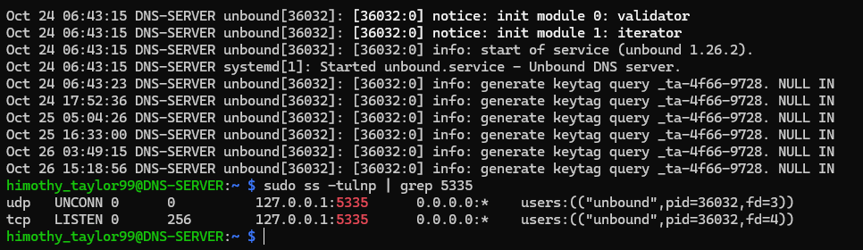

*Figure 2 — TCP and UDP listeners bound to the loopback address on port 5335.*

---

## Step 3 — Validate the Unbound Configuration

I ran:

```bash
sudo unbound-checkconf
```

The configuration validator returned:

```text
unbound-checkconf: no errors in /etc/unbound/unbound.conf
```

This confirms the configuration passed Unbound's validation check; it does not by itself demonstrate successful DNS queries.


*Figure 3 — Unbound reports no configuration errors.*

---

## Step 4 — Test Direct DNS Resolution

To test Unbound independently of AdGuard Home, I queried the local resolver:

```bash
dig @127.0.0.1 -p 5335 example.com A
```

Observed results:

| Field | Result |
|---|---|
| Resolver | `127.0.0.1#5335` |
| Status | `NOERROR` |
| Record type | `A` |
| Answers | `172.66.147.243`, `104.20.23.154` |
| Query time | 59 ms |
| Transport | UDP |

The successful response demonstrates that Unbound answered an IPv4 DNS lookup on its configured local port.

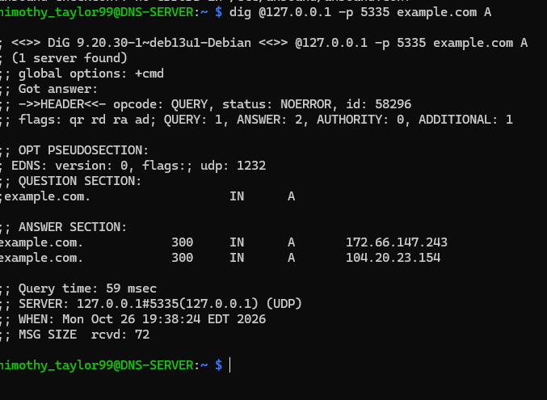

*Figure 4 — Successful example.com resolution through Unbound at 127.0.0.1:5335.*

---

## Step 5 — Verify AdGuard Home Upstream Configuration

In **AdGuard Home → Settings → DNS settings**, I inspected the **Upstream DNS servers** field.

The configured upstream was:

```text
127.0.0.1:5335
```

The screenshot showed this as the only listed upstream server, with **Load-balancing** selected as the upstream selection mode.

This establishes that AdGuard Home was configured to send upstream DNS requests to local Unbound.

A configuration screenshot alone does not trace the network path of individual DNS queries.

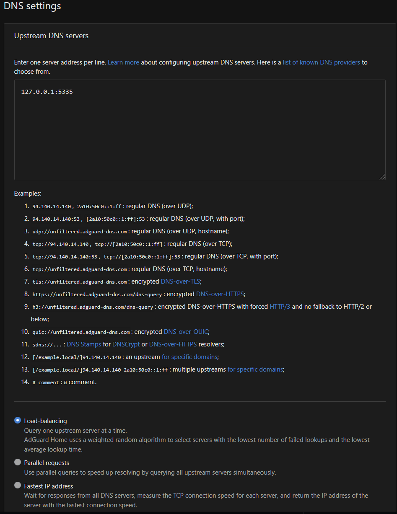

*Figure 5 — AdGuard Home configured to use the local Unbound resolver on port 5335.*

---

## Step 6 — Validate DNSSEC Behavior

I tested a correctly signed domain and a deliberately broken DNSSEC domain directly against Unbound:

```bash
dig @127.0.0.1 -p 5335 cloudflare.com A +dnssec
dig @127.0.0.1 -p 5335 dnssec-failed.org A +dnssec
```

| Test | Observed result |
|---|---|
| `cloudflare.com` | `NOERROR`, two A records and an RRSIG record |
| `dnssec-failed.org` | `SERVFAIL`, zero answers |

The valid signed domain resolved, while the deliberately invalid DNSSEC test domain failed.

Together, these results provide strong evidence of functioning DNSSEC validation.

The positive response did not visibly contain the `ad` flag, so the conclusion relies on the paired positive/negative test behavior rather than claiming that the flag was observed.

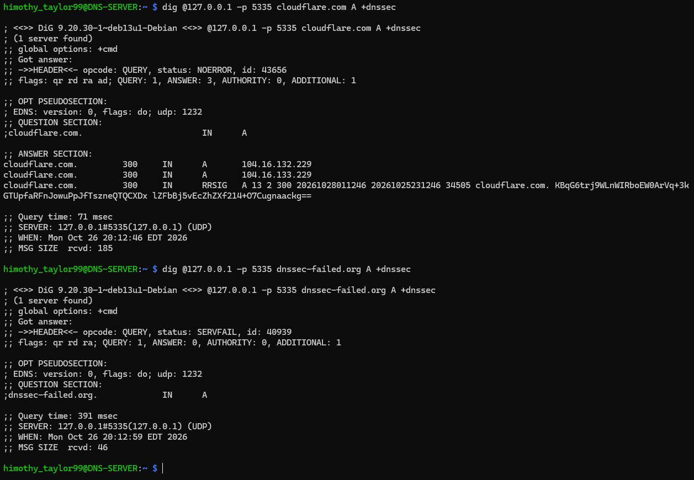

*Figure 6 — Signed-domain resolution succeeds while the deliberately invalid DNSSEC domain returns SERVFAIL.*

---

## Step 7 — Validate DNS Resolution Through AdGuard Home

Finally, I sent a DNS query to AdGuard Home's LAN-facing DNS service:

```bash
dig @172.16.0.57 example.com A
```

Observed results:

| Field | Result |
|---|---|
| DNS server | `172.16.0.57#53` |
| Status | `NOERROR` |
| Answers | `172.66.147.243`, `104.20.23.154` |
| Query time | 19 ms |
| Transport | UDP |
| Response flags | Included `ad` |

This confirms that AdGuard Home answered the DNS request successfully.

The `ad` flag indicates that the response was marked as authenticated.

Combined with the upstream setting and direct Unbound tests, this supports the intended integration; it does not independently trace every resolver hop.

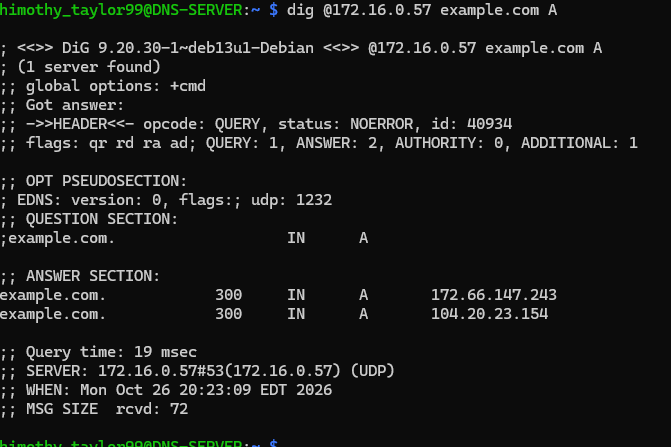

*Figure 7 — Successful DNS resolution through AdGuard Home at 172.16.0.57:53.*

---

## Challenges & Solutions

### Separating AdGuard Home and Unbound on the Same Raspberry Pi

**Challenge:** Both services perform DNS-related work, so their listening ports must not conflict.

**Implementation verified:** AdGuard Home served client DNS on port 53, while Unbound listened locally on port 5335.

### Proving DNSSEC Rather Than Assuming It from Successful Resolution

**Challenge:** A successful DNS lookup alone does not establish DNSSEC validation.

**Solution:** I compared a valid signed domain (`cloudflare.com`) with an intentionally invalid DNSSEC domain (`dnssec-failed.org`).

The expected `NOERROR` and `SERVFAIL` responses were observed.

### Avoiding Overstatement of Recursive DNS Operation

**Limitation:** The collected evidence confirms Unbound's operation and AdGuard Home's upstream setting, but does not include the Unbound configuration directives or a trace proving whether Unbound performs full recursion instead of forwarding.

**Documentation approach:** Describe full recursion as the intended architecture until the relevant configuration is inspected.

---

## Phase 7 Results

- Verified that Unbound 1.26.2 was enabled and running.
- Confirmed local UDP and TCP listeners on `127.0.0.1:5335`.
- Validated the Unbound configuration without errors.
- Resolved `example.com` directly through Unbound.
- Confirmed AdGuard Home's upstream setting pointed to local Unbound.
- Observed successful DNSSEC positive and negative test behavior.
- Resolved `example.com` through AdGuard Home at `172.16.0.57:53`.
- Collected seven original screenshots documenting the validation sequence.

### Evidence Limitations

These screenshots do not independently prove reboot persistence, full iterative recursion rather than forwarding, or the precise upstream path of each DNS query.

No additional configuration files or packet traces were collected as part of this documented validation sequence.

**Phase 7 Status: Validation Complete**

---

---

# Phase 8 — SSH Hardening & System Security

## Objective

In this phase, I validated the Raspberry Pi DNS server's remote-access controls, host firewall, automatic update configuration, and essential service health. The goal was to reduce unnecessary access while keeping SSH administration, AdGuard Home DNS filtering, and Unbound DNS resolution operational.

This section documents **observed lab results**, not assumed settings. All screenshots are from the actual Raspberry Pi environment.

---

## Step 1 — Validate SSH Server Hardening

After successfully connecting to the Raspberry Pi with an existing Ed25519 SSH key, I inspected the effective SSH daemon settings:

```bash
sudo sshd -T | grep -Ei '^(pubkeyauthentication|passwordauthentication|permitrootlogin|kbdinteractiveauthentication|authenticationmethods) '
```

The server returned:

```text
permitrootlogin no
pubkeyauthentication yes
passwordauthentication no
kbdinteractiveauthentication no
authenticationmethods any
```

| Setting | Observed value | Security significance |
|---|---|---|
| `permitrootlogin` | `no` | Direct SSH login as root is disabled |
| `pubkeyauthentication` | `yes` | Public-key authentication is enabled |
| `passwordauthentication` | `no` | SSH password authentication is disabled |
| `kbdinteractiveauthentication` | `no` | Keyboard-interactive SSH authentication is disabled |
| `authenticationmethods` | `any` | Any permitted, enabled authentication method may satisfy login; this does **not** allow anonymous access |

An earlier SSH attempt without explicitly selecting the custom key returned `Permission denied (publickey)`. Using the existing private key with `ssh -i` successfully authenticated. This supports that the server accepted the authorized key, while the effective settings independently establish the password-login restrictions.

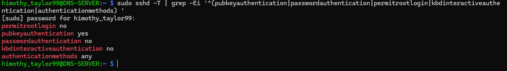

*Figure 1 — Effective SSH settings show public-key authentication enabled and password, keyboard-interactive, and root SSH logins disabled.*

---

## Step 2 — Inspect UFW Firewall Rules

I checked the active firewall configuration:

```bash
sudo ufw status verbose
```

Observed policies:

```text
Status: active
Logging: on (low)
Default: deny (incoming), allow (outgoing), disabled (routed)
```

The firewall displayed these inbound allow rules:

| Destination | Protocol | Allowed source | Purpose |
|---|---|---|---|
| `172.16.0.57:53` | UDP | `172.16.0.0/24` | AdGuard Home DNS |
| `172.16.0.57:53` | TCP | `172.16.0.0/24` | AdGuard Home DNS |
| `172.16.0.57:80` | TCP | `172.16.0.0/24` | AdGuard Home web interface |
| Port `22` | TCP | `172.16.0.0/24` | SSH administration |

The default-deny incoming policy reduces exposure by allowing only explicitly permitted traffic. Both TCP and UDP DNS are allowed for LAN clients. SSH and the web administration interface are also limited by source subnet, although devices on that subnet may still attempt to connect.

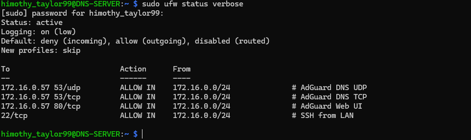

*Figure 2 — UFW active with default-deny incoming policy and LAN-scoped DNS, web, and SSH rules.*

**Scope:** These rules demonstrate host-firewall configuration. They do not prove the absence of router port forwarding, and the screenshot is not a packet-level firewall enforcement test.

---

## Step 3 — Verify the Unattended-Upgrades Service

I inspected the service:

```bash
sudo systemctl status unattended-upgrades --no-pager
```

The service was **loaded**, **enabled**, and **active (running)**. Its systemd description was **Unattended Upgrades Shutdown**.

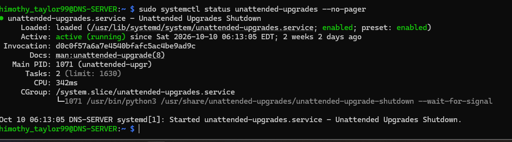

*Figure 3 — Unattended Upgrades Shutdown service is enabled and running.*

This service status alone does not establish that automatic package installations are scheduled or have succeeded. I verified those points separately.

---

## Step 4 — Verify Automatic Update Scheduling

I inspected the APT periodic configuration:

```bash
sudo grep -RhsE '^[[:space:]]*APT::Periodic::(Update-Package-Lists|Unattended-Upgrade)' /etc/apt/apt.conf /etc/apt/apt.conf.d/ 2>/dev/null
```

Observed output:

```text
APT::Periodic::Update-Package-Lists "1";
APT::Periodic::Unattended-Upgrade "1";
```

These directives configure periodic package-list updates and unattended upgrades with a daily interval. They do not guarantee that an eligible package will be available on every run.

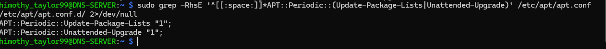

*Figure 4 — APT periodic settings specify daily package-list refresh and unattended upgrades.*

---

## Step 5 — Review Automatic Upgrade History

I checked the unattended-upgrades log:

```bash
sudo tail -n 35 /var/log/unattended-upgrades/unattended-upgrades.log
```

The log showed permitted Debian `trixie` and `trixie-security` package origins and recorded the following events:

| Date | Observed event | Result |
|---|---|---|
| October 24, 2026 | `unbound` selected for upgrade | `All upgrades installed` |
| October 25, 2026 | `libbrotli1` selected for upgrade | `All upgrades installed` |
| October 26, 2026 | Unattended-upgrades run | No eligible packages found; no pending auto-removals |

These entries demonstrate that unattended upgrades actually ran and successfully installed packages, rather than merely being enabled in configuration.

The log also reported that battery-status checks were skipped because `powermgmt-base` was not installed. This message was not presented as an installation failure.

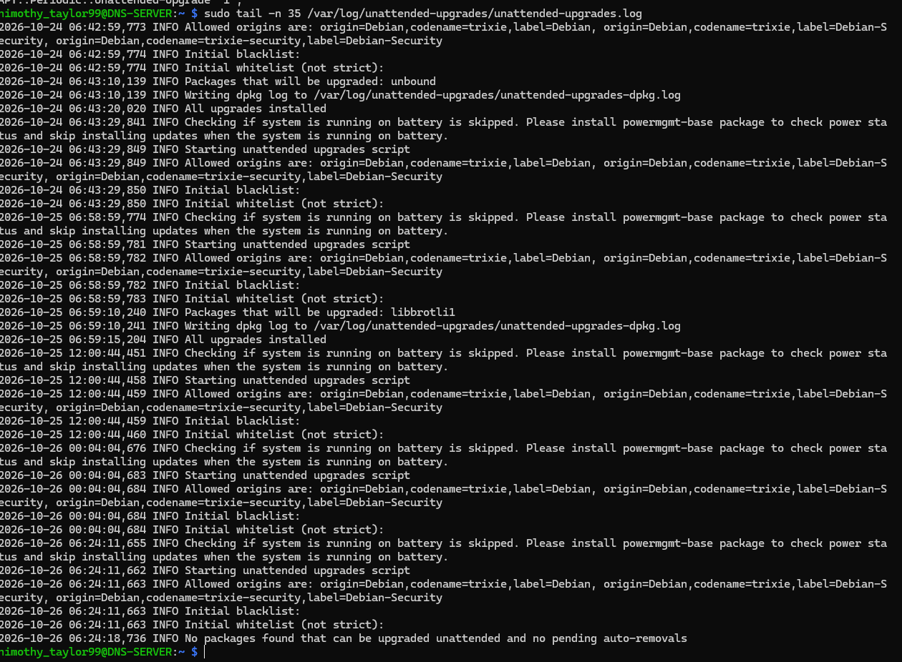

*Figure 5 — Upgrade logs identify allowed repositories, successful package installations, and a later run with no pending eligible upgrades.*

---

## Step 6 — Confirm Essential Services Remain Active

Finally, I verified the status of the three services required for remote administration and DNS operation:

```bash
sudo systemctl is-active ssh unbound AdGuardHome
```

Observed output, in the same order as the service names:

```text
active
active
active
```

| Service | Observed status | Role |
|---|---|---|
| `ssh` | `active` | Remote administration |
| `unbound` | `active` | Local DNS resolver |
| `AdGuardHome` | `active` | Client-facing DNS filtering |

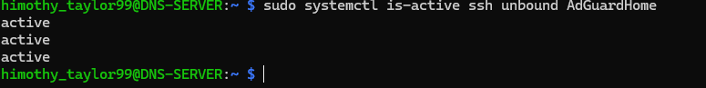

*Figure 6 — SSH, Unbound, and AdGuard Home all reported active service states.*

This confirms service activity at the time of testing. It is not a substitute for the DNS resolution and DNSSEC tests documented in Phase 7.

---

## Challenges & Solutions

### Securing SSH without losing administrative access

**Challenge:** Disabling SSH password authentication can prevent remote access if the correct key is unavailable.

**Approach:** I used an existing Ed25519 key to establish access and then verified the effective SSH restrictions. The working SSH session was preserved while checking settings.

### Restricting access while maintaining DNS availability

**Challenge:** A default-deny firewall must still permit necessary DNS and administrative traffic.

**Approach:** The observed UFW rules allowed DNS over TCP and UDP, AdGuard Home's web interface, and SSH from the local subnet. A final service-status check confirmed the core daemons remained active.

### Distinguishing update configuration from actual update execution

**Challenge:** A running unattended-upgrades service does not independently prove updates are being installed.

**Approach:** I checked the APT periodic settings and the unattended-upgrades log, which recorded successful `unbound` and `libbrotli1` package upgrades.

---

## Phase 8 Results

- Verified SSH public-key authentication was enabled and SSH password, keyboard-interactive, and root login were disabled.
- Confirmed UFW was active with default-deny incoming traffic and LAN-restricted access to SSH, DNS, and the AdGuard Home web interface.
- Verified the unattended-upgrades shutdown service was running.
- Confirmed APT was configured to run periodic updates daily.
- Verified successful unattended package upgrades from actual logs.
- Confirmed `ssh`, `unbound`, and `AdGuardHome` all reported `active`.
- Captured six original screenshots for the GitHub portfolio.

### Evidence Limitations

The captured evidence does not establish router-side WAN exposure, packet-level enforcement of each firewall rule, reboot persistence of all services, or the security state of other devices on the LAN. The effective `sshd -T` output represents the default evaluated configuration; connection-specific `Match` directives were not separately tested.

**Phase 8 Status: Validation Complete**

---

---

# Phase 9 — DNS Security Testing & Validation

## Objective

In this phase, I performed a series of DNS security and functionality tests to validate my Raspberry Pi DNS server after configuring AdGuard Home, integrating Unbound, enabling DNSSEC validation, and hardening the system.

The objective was to confirm that the DNS server could successfully resolve legitimate domains, block advertising-related domains, reject invalid DNSSEC responses, recover after a service restart, and function as the configured DNS server for my Windows PC.

All tests were performed using my actual lab environment, with screenshots documenting the observed results.

### Lab Environment

| Component | Configuration |
|---|---|
| DNS server | Raspberry Pi 4 |
| Hostname | DNS-SERVER |
| DNS server IP | 172.16.0.57 |
| Operating system | Raspberry Pi OS Lite (64-bit) |
| DNS filtering | AdGuard Home |
| Local upstream resolver | Unbound |
| Unbound endpoint | 127.0.0.1:5335 |
| Client operating system | Windows |
| Client connection | Ethernet |
| Local subnet | 172.16.0.0/24 |

---

## Step 1 — Verify DNS Resolution from Windows

The first test was designed to confirm that my Windows PC could communicate with the Raspberry Pi DNS server and successfully resolve a legitimate domain.

I opened Windows PowerShell and executed:

```powershell
nslookup example.com 172.16.0.57
```

### Observed Results

```text
Server:  DNS-SERVER
Address: 172.16.0.57

Non-authoritative answer:
Name:    example.com
Addresses: 2606:4700:10::6814:179a
           2606:4700:10::ac42:93f3
           104.20.23.154
           172.66.147.243
```

The DNS query completed successfully and returned both IPv4 and IPv6 addresses.

This confirmed that my Windows PC could reach the Raspberry Pi's DNS endpoint and receive a valid DNS response.

Because the server address was explicitly specified, this test did not establish whether Windows was using the Raspberry Pi as its default DNS server. That was tested separately later in the phase.

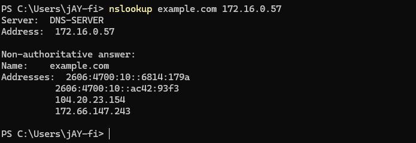

*Figure 1 — Windows PowerShell successfully resolves example.com using the Raspberry Pi DNS server at 172.16.0.57.*

---

## Step 2 — Validate DNS Filtering

Next, I tested whether AdGuard Home could block a domain associated with advertising services.

From Windows PowerShell, I executed:

```powershell
nslookup doubleclick.net 172.16.0.57
```

### Observed Results

```text
Server:  DNS-SERVER
Address: 172.16.0.57

Non-authoritative answer:
Name:    doubleclick.net
Addresses: ::
           0.0.0.0
```

Instead of returning the domain's normal public IP addresses, the DNS server returned:

- `0.0.0.0` — null IPv4 address
- `::` — unspecified IPv6 address

These responses are consistent with AdGuard Home's DNS blocking behavior.

### Result

The test confirmed that the DNS filtering configuration successfully blocked the tested advertising-related domain.

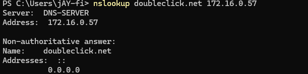

*Figure 2 — AdGuard Home returns null IPv4 and IPv6 addresses for doubleclick.net, demonstrating DNS filtering.*

---

## Step 3 — Validate DNSSEC Enforcement

DNSSEC (Domain Name System Security Extensions) helps protect DNS integrity by allowing validating resolvers to detect improperly signed or tampered DNS data.

Because my DNS architecture uses Unbound as AdGuard Home's upstream resolver, I tested whether the client-facing DNS server would reject a domain intentionally configured with invalid DNSSEC signatures.

I executed:

```powershell
nslookup dnssec-failed.org 172.16.0.57
```

### Observed Results

```text
Server:  DNS-SERVER
Address: 172.16.0.57

*** DNS-SERVER can't find dnssec-failed.org: Server failed
```

The query returned a server failure rather than a normal DNS answer.

The domain `dnssec-failed.org` is designed to fail DNSSEC validation.

### Result

This result was consistent with successful DNSSEC enforcement. Combined with the direct Unbound DNSSEC tests performed in Phase 7, it provided supporting evidence that invalid DNSSEC responses were being rejected through the configured DNS setup.

The failure response alone does not identify the internal cause of every possible DNS failure.

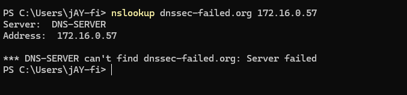

*Figure 3 — The Raspberry Pi DNS server returns a server failure when querying an intentionally invalid DNSSEC test domain.*

---

## Step 4 — Test AdGuard Home Service Recovery

To evaluate service recovery, I performed a controlled restart of AdGuard Home and verified that it returned to an operational state.

I connected to the Raspberry Pi through SSH and executed:

```bash
sudo systemctl restart AdGuardHome
```

After the restart, I checked the service state:

```bash
sudo systemctl is-active AdGuardHome
```

### Observed Result

```text
active
```

I then inspected the service details:

```bash
sudo systemctl status AdGuardHome --no-pager
```

The service reported:

```text
Loaded: loaded
Active: active (running)
```

The startup logs also confirmed that AdGuard Home initialized its network listeners.

### Verified Network Listeners

| Service | Address | Port |
|---|---|---|
| DNS over UDP | 172.16.0.57 | 53 |
| DNS over TCP | 172.16.0.57 | 53 |
| AdGuard Home web interface | 172.16.0.57 | 80 |

The service was also marked as enabled in systemd.

### Result

AdGuard Home successfully restarted, returned to an active state, and initialized its DNS and web interface listeners.

No startup errors were visible in the captured status output.

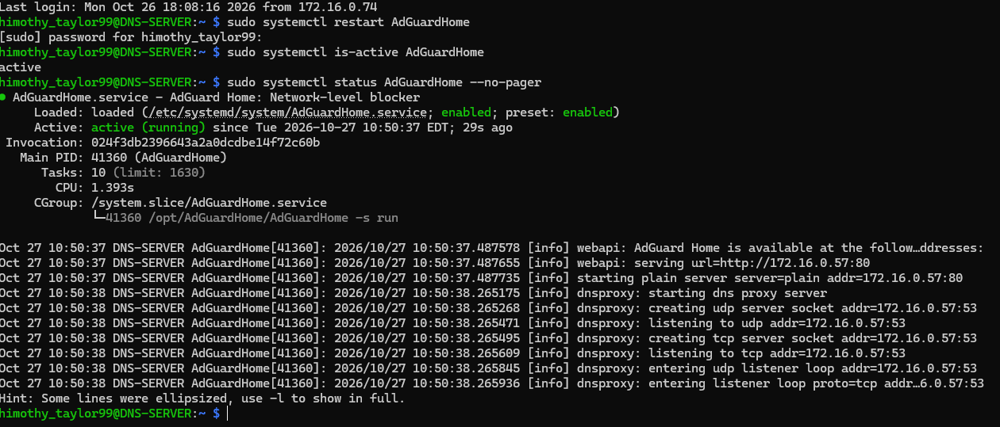

*Figure 4 — AdGuard Home successfully restarts, reports an active running state, and initializes its DNS listeners.*

---

## Step 5 — Verify DNS Resolution and Filtering After Restart

Although the service reported that it was running, I wanted to verify that it could still perform its primary functions from a separate network client.

I returned to Windows PowerShell and performed two additional tests.

### Test A — Normal DNS Resolution

```powershell
nslookup example.com 172.16.0.57
```

Observed results:

```text
Server:  DNS-SERVER
Address: 172.16.0.57

Non-authoritative answer:
Name:    example.com
Addresses: 2606:4700:10::6814:179a
           2606:4700:10::ac42:93f3
           172.66.147.243
           104.20.23.154
```

The DNS server successfully resolved the legitimate domain after restarting.

### Test B — DNS Filtering

```powershell
nslookup doubleclick.net 172.16.0.57
```

Observed results:

```text
Server:  DNS-SERVER
Address: 172.16.0.57

Non-authoritative answer:
Name:    doubleclick.net
Addresses: ::
           0.0.0.0
```

The DNS server continued returning blocking responses for the advertising-related domain.

### Result

Both tests passed.

The results demonstrated that AdGuard Home recovered its DNS resolution and filtering functionality after the controlled service restart.

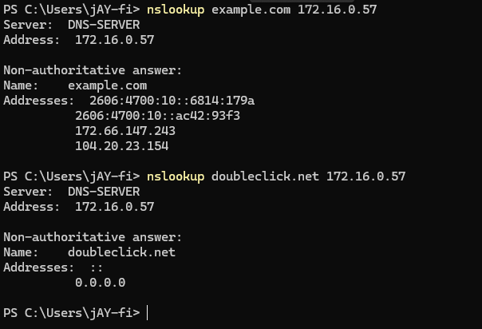

*Figure 5 — Windows successfully resolves example.com and receives a blocking response for doubleclick.net after AdGuard Home restarts.*

---

## Step 6 — Verify Windows DNS Client Configuration

Earlier tests explicitly directed DNS queries to the Raspberry Pi. I next verified that my Windows Ethernet adapter was actually configured to use the Raspberry Pi as its DNS server.

From Windows PowerShell, I executed:

```powershell
Get-DnsClientServerAddress -AddressFamily IPv4
```

### Observed Results

```text
InterfaceAlias             InterfaceIndex AddressFamily ServerAddresses
--------------             -------------- ------------- ---------------
Ethernet                   9              IPv4          {172.16.0.57}
Loopback Pseudo-Interface 1 1             IPv4          {}
```

### Configuration Findings

| Setting | Observed value |
|---|---|
| Network adapter | Ethernet |
| Interface index | 9 |
| Address family | IPv4 |
| Configured DNS server | 172.16.0.57 |
| Additional IPv4 DNS servers | None listed |

This confirmed that the Windows Ethernet adapter was configured to use the Raspberry Pi as its IPv4 DNS server.

The test did not separately inspect IPv6 DNS settings or all possible application-specific DNS behavior.

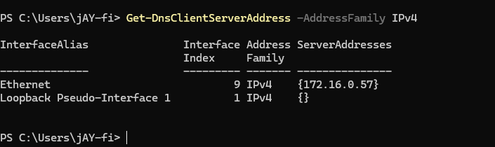

*Figure 6 — Windows PowerShell confirms that the Ethernet adapter uses 172.16.0.57 as its configured IPv4 DNS server.*

---

## Step 7 — Validate Default DNS Resolution

For the final client-side test, I verified that Windows could automatically select the Raspberry Pi DNS server without manually specifying its address.

I executed:

```powershell
nslookup example.com
```

Unlike previous queries, this command did not include a DNS server IP address.

### Observed Results

```text
Server:  DNS-SERVER
Address: 172.16.0.57

Non-authoritative answer:
Name:    example.com
Addresses: 2606:4700:10::6814:179a
           2606:4700:10::ac42:93f3
           172.66.147.243
           104.20.23.154
```

### Result

Windows automatically selected `DNS-SERVER` at `172.16.0.57` and successfully resolved the domain.

This demonstrated that ordinary Windows `nslookup` queries could use the Raspberry Pi DNS server without explicitly specifying its IP address.

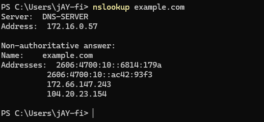

*Figure 7 — Windows automatically selects the Raspberry Pi DNS server and successfully resolves example.com without a manually specified server address.*

---

## Challenges & Solutions

### Challenge 1 — Distinguishing DNS Reachability from Default DNS Configuration

**Challenge:** A successful query directed to a specific DNS server does not prove that the client normally uses that server.

**Solution:** I inspected the Windows Ethernet adapter's DNS configuration and then performed a lookup without specifying a DNS server. Both tests confirmed that the Raspberry Pi was selected for normal Windows nslookup requests.

### Challenge 2 — Confirming Filtering Rather Than Basic DNS Resolution

**Challenge:** Successful DNS resolution alone does not demonstrate that AdGuard Home is blocking unwanted domains.

**Solution:** I tested an advertising-related domain and verified that the server returned null IPv4 and IPv6 addresses instead of normal public addresses.

### Challenge 3 — Verifying Service Functionality After Restart

**Challenge:** A service can report an active state even if its application-level functionality is not operating correctly.

**Solution:** After restarting AdGuard Home, I performed additional DNS resolution and filtering tests from Windows to confirm that both functions remained operational.

### Challenge 4 — Interpreting DNSSEC Failure Responses

**Challenge:** A DNS server failure can have multiple causes, so a single failed lookup is not sufficient to prove the complete DNSSEC validation process.

**Solution:** I used a deliberately invalid DNSSEC test domain and interpreted the result alongside the direct Unbound DNSSEC validation evidence collected in Phase 7.

---

## Phase 9 Results

| Validation | Observed result | Status |
|---|---|---|
| Windows DNS resolution | Valid IPv4 and IPv6 answers returned | PASS |
| DNS filtering | Null addresses returned for doubleclick.net | PASS |
| DNSSEC enforcement | Server failure for dnssec-failed.org | PASS |
| AdGuard Home restart | Service returned to active running state | PASS |
| Post-restart DNS functionality | Resolution and filtering both successful | PASS |
| Windows IPv4 DNS configuration | Ethernet configured with 172.16.0.57 | PASS |
| Default Windows DNS resolution | Raspberry Pi automatically selected | PASS |

### Key Accomplishments

- Validated DNS communication between Windows and the Raspberry Pi.
- Demonstrated DNS filtering using a known advertising-related domain.
- Confirmed the expected failure response for invalid DNSSEC data.
- Performed a controlled AdGuard Home service restart.
- Verified DNS resolution and filtering after the restart.
- Confirmed Windows Ethernet was configured to use the Raspberry Pi as its IPv4 DNS server.
- Demonstrated default DNS resolution without manually specifying the server.
- Captured seven screenshots documenting the actual results.

---

## Evidence Limitations

These tests validate specific observed behaviors within the home lab environment.

They do not independently prove:

- That every application on Windows uses the Raspberry Pi for all DNS requests.
- That IPv6 DNS configuration cannot provide an alternative resolver.
- That DNS-over-HTTPS or other encrypted DNS mechanisms cannot bypass local filtering.
- That all advertising, tracking, or malicious domains are blocked.
- That the DNS server remains available during a Raspberry Pi hardware failure.
- That service recovery occurs automatically after an unexpected crash or power loss.
- That every DNS query is recursively resolved through Unbound.

The controlled restart and subsequent queries demonstrate successful recovery from that particular restart, not a full high-availability or disaster-recovery test.

---

## Phase 9 Conclusion

Phase 9 successfully validated the DNS server's primary functionality and several important security behaviors.

The results demonstrated that my Raspberry Pi could provide DNS resolution to a Windows client, block the tested advertising domain, return the expected failure for invalid DNSSEC data, recover after a controlled AdGuard Home restart, and serve as the configured IPv4 DNS server for Windows.

Together with the previous installation, networking, DNSSEC, and system-hardening phases, these results provide documented evidence of a functioning Raspberry Pi DNS security lab.

**Phase 9 Status: Validation Complete**

**Next Phase: Phase 10 — Monitoring, Logging & Performance Metrics**

---
