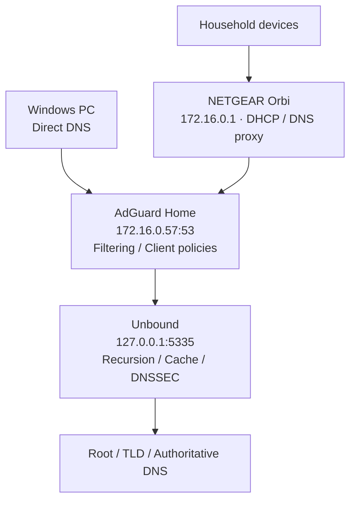
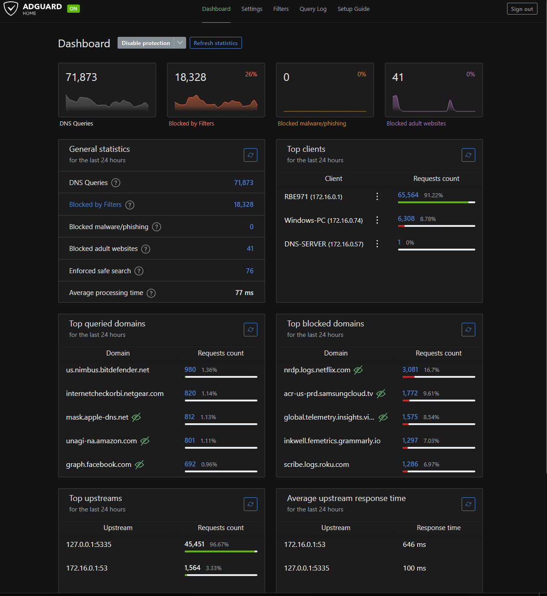
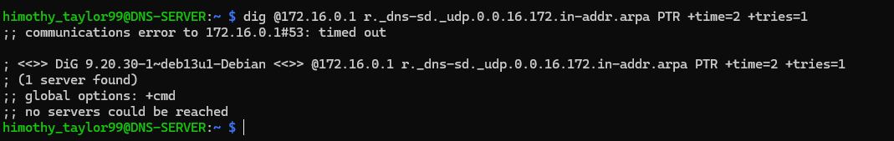
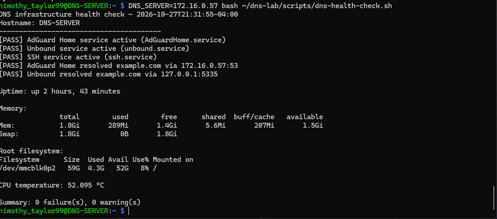

# 🛡️ Raspberry Pi DNS Security Lab

**Linux Administration · Networking · DNS Security · Infrastructure Monitoring**

Built a Raspberry Pi 4 DNS security server for my home network using **AdGuard Home** for filtering and **Unbound** for recursive DNS resolution, caching, and DNSSEC validation. This portfolio project documents hands-on Linux deployment, router integration, security hardening, troubleshooting, testing, and Bash automation.

## Architecture

[Architecture notes](diagrams/dns-architecture.md) · [Bash health-check script](scripts/dns-health-check.sh)

## Project Results

| Area | Documented result |
|---|---|
| DNS services | AdGuard Home at `172.16.0.57:53`; Unbound restricted to `127.0.0.1:5335` |
| Filtering snapshot | **71,873 DNS queries**, **18,328 blocked** (~25.5%) during a recorded 24-hour dashboard period |
| Windows benchmark | **10/10 successful DNS lookups**; 13.32 ms average across the measured sample |
| Security | SSH key authentication, password login disabled, UFW LAN rules, unattended updates |
| Monitoring | Service logs, query statistics, cache metrics, resource checks, and Bash health checks |
| Troubleshooting | Isolated router DNS-SD failures from successful ordinary PTR resolution; root cause remains unconfirmed |

*These are observed test snapshots, not guaranteed long-term performance or availability metrics.*

## Tools & Skills

**Hardware:** Raspberry Pi 4, 64 GB microSD, NETGEAR Orbi router, Windows PC.

**Software:** Raspberry Pi OS Lite (64-bit), AdGuard Home, Unbound, OpenSSH, UFW, NetworkManager, Bash, systemd, journalctl, dig, nslookup.

**Skills demonstrated:** Linux server administration, DHCP and DNS integration, recursive resolution, DNSSEC, DNS filtering, SSH security, firewalling, incident investigation, monitoring, scripting, and technical documentation.

## Technical Walkthrough

The full deployment, configuration, evidence, and troubleshooting steps are organized by phase:

| Phase | Documentation |
|---|---|
| 2 — Raspberry Pi OS deployment | [OS deployment](docs/01-os-deployment.md) |
| 3 — Network configuration | [Network and DHCP reservation](docs/02-network-configuration.md) |
| 4 — AdGuard Home | [Installation and validation](docs/03-adguard-installation.md) |
| 5 — Network-wide DNS | [Router and Windows integration](docs/04-dns-configuration.md) |
| 6 — Client filtering | [Client-specific security policies](docs/05-client-family-filtering.md) |
| 7 — Unbound | [Recursive DNS and DNSSEC](docs/06-unbound.md) |
| 8 — Security | [SSH, UFW, updates](docs/07-security.md) |
| 9 — Validation | [DNS testing and recovery](docs/08-testing-validation.md) |
| 10 — Monitoring | [Logging, performance, troubleshooting](docs/09-monitoring-troubleshooting.md) |
| 11 — Final verification | [Health-check validation](docs/11-health-check-validation.md) |

[Original comprehensive README archive](docs/README-original-archive.md) retains the detailed project history and original evidence references.

## Evidence Gallery

**AdGuard Home dashboard and activity**

**DNS service-discovery troubleshooting**

**Automated Bash health check**

## Engineering Notes

The Orbi router acts as a DNS proxy for many automatically configured household devices, which can hide individual client identities from AdGuard Home. Direct Windows DNS configuration was used to enable device-specific policy testing. During troubleshooting, ordinary LAN PTR queries worked, but certain DNS-SD discovery requests returned errors or timed out. This behavior was documented without claiming an unverified fix.

## Project Outcome

This lab demonstrates the complete lifecycle of a small Linux network service: **deploy → configure → secure → validate → monitor → troubleshoot → document**. It was built as practical preparation for cloud infrastructure, data center operations, network engineering, and security-focused IT support roles.

**Author:** Travis Taylor · [LinkedIn](https://www.linkedin.com/in/travis-taylor-465140281)
