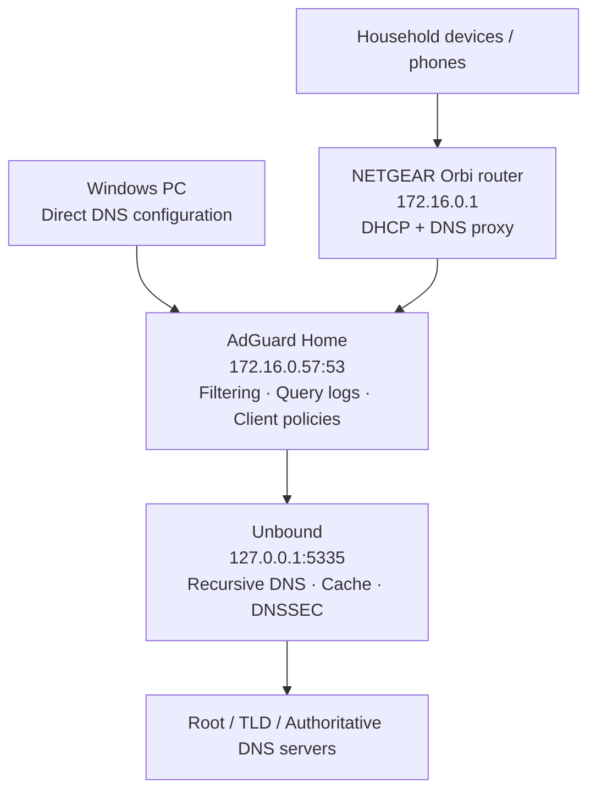

# DNS Infrastructure Architecture

**DNS request direction:** clients → AdGuard Home → Unbound → authoritative DNS infrastructure. Replies travel in the reverse direction. Unbound listens on loopback only. The router proxies many household queries, so direct Windows DNS configuration enables more precise client-specific filtering.

[← Project overview](../README.md)
